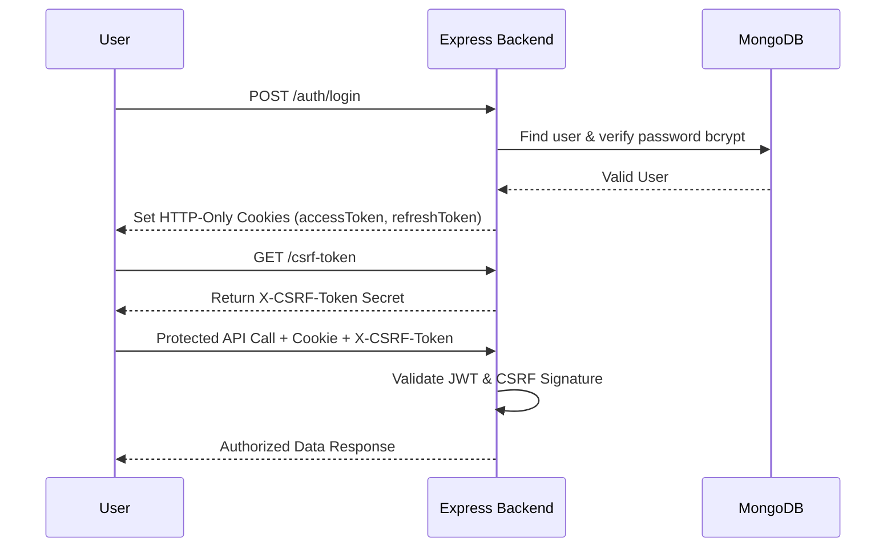
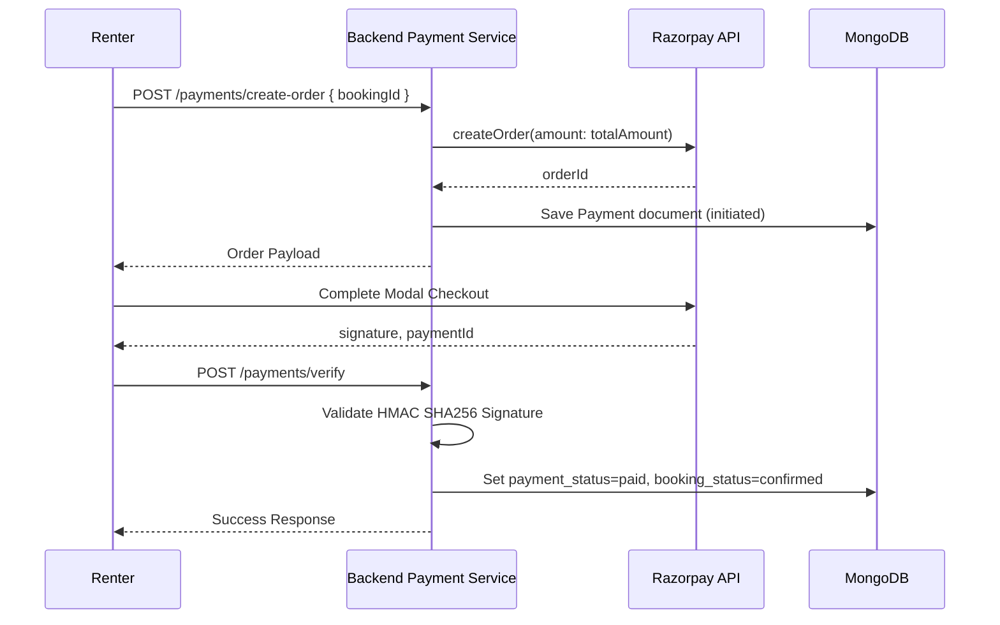
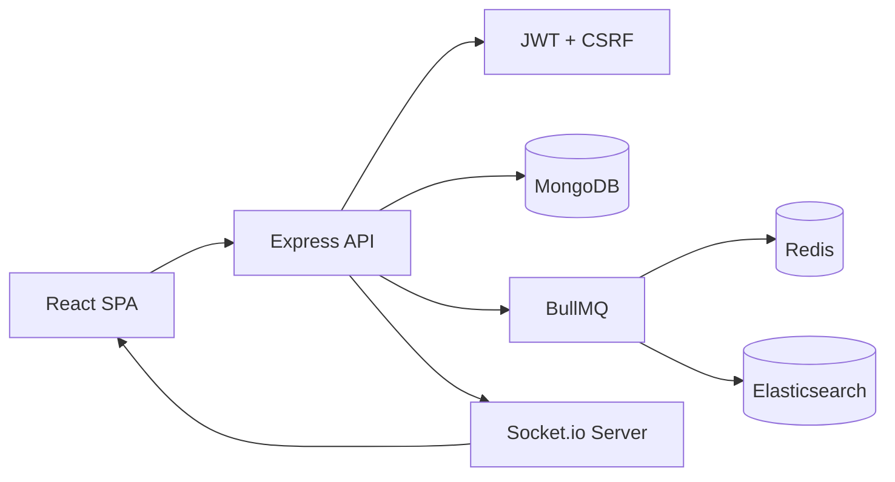

# Rentora — Comprehensive Technical & Architectural Documentation

This document serves as the authoritative, end-to-end technical reference for **Rentora**, an enterprise-grade peer-to-peer (P2P) rental marketplace.

---

## 📑 Table of Contents
1. [Project Overview](#1-project-overview)
2. [Complete Tech Stack](#2-complete-tech-stack)
3. [Folder Structure](#3-folder-structure)
4. [Complete Feature List](#4-complete-feature-list)
5. [API Documentation](#5-api-documentation)
6. [Database Design](#6-database-design)
7. [Authentication Architecture](#7-authentication-architecture)
8. [Booking Lifecycle](#8-booking-lifecycle)
9. [Razorpay Architecture](#9-razorpay-architecture)
10. [Socket.io Architecture](#10-socketio-architecture)
11. [Search Architecture](#11-search-architecture)
12. [BullMQ Architecture](#12-bullmq-architecture)
13. [Cloudinary Integration](#13-cloudinary-integration)
14. [Notifications System](#14-notifications-system)
15. [Security Engineering](#15-security-engineering)
16. [System Architecture Diagrams](#16-system-architecture-diagrams)
17. [Design Patterns & SOLID Principles](#17-design-patterns--solid-principles)
18. [End-to-End Project Flows](#18-end-to-end-project-flows)
19. [Deployment Guide](#19-deployment-guide)
20. [Interview & Technical Deep Dive Guide](#20-interview--technical-deep-dive-guide)

---

## 1. Project Overview

### What is Rentora?
Rentora is a full-stack, real-time peer-to-peer (P2P) rental platform designed to enable users to list, search, rent, and manage physical items in their local communities.

### Problem Statement
Most consumer goods (tools, DSLR cameras, sports gear, party equipment, heavy machinery) remain idle for over 90% of their lifespan. Meanwhile, consumers needing these items for short durations face high capital purchase costs.

### Solution
Rentora connects item owners with renters, facilitating short-term rentals backed by strict state-machine booking lifecycles, verified payment gateways, real-time messaging, and fuzzy search indexing.

### Business Goals & Target Users
- **Target Users**: Renters seeking short-term access; Owners monetizing idle physical assets.
- **Business Goals**: Standardized 10% platform commission fee on transactions, zero double-booking occurrences, sub-100ms real-time chat latency, and high search relevance.

---

## 2. Complete Tech Stack

| Domain | Technology | Justification |
|---|---|---|
| **Frontend Framework** | React 18 + Vite | Lightning-fast HMR, component modularity, optimized production bundles. |
| **Routing** | React Router v7 | Nested route layouts, role-based protection guards, location state tracking. |
| **Styling** | Tailwind CSS + CSS3 | Utility-first design system with curated dark-mode glassmorphism tokens. |
| **Backend Runtime** | Node.js (v18+) + Express | Event-driven, non-blocking I/O ideal for real-time WebSocket and HTTP traffic. |
| **Language** | TypeScript (v5) | End-to-end type safety, strict interface contracts, early compile-time bug detection. |
| **Database & ORM** | MongoDB + Mongoose | Schema flexibility for heterogeneous item attributes combined with Mongoose transactions. |
| **Caching & Messaging** | Redis | In-memory pub/sub broker for BullMQ job queues and fast token storage. |
| **Background Jobs** | BullMQ | Distributed task queue managing emails, status updates, and Elasticsearch syncing. |
| **Search Engine** | Elasticsearch (v8) | Multi-field fuzzy matching with auto-relevance scoring and fallback to DB queries. |
| **Real-time WebSockets**| Socket.io (v4) | Room-based bidirectional communication with fallback to polling and cookie auth. |
| **Payment Gateway** | Razorpay SDK | Robust Indian payment processing supporting UPI, cards, netbanking with signature verification. |
| **Cloud CDN** | Cloudinary SDK | Direct cloud image processing, transformation, and CDN hosting. |

---

## 3. Folder Structure

```
Rentora/
├── backend/
│   ├── src/
│   │   ├── config/          # Centralized configuration (env, redis, socket, database, Sentry, Cloudinary)
│   │   ├── controllers/     # HTTP Request/Response orchestrators
│   │   ├── middlewares/     # Auth checks (verifyUser, restrictTo), CSRF guards, Global Error Handler
│   │   ├── models/          # Mongoose document models (User, Item, Booking, Message, Notification, etc.)
│   │   ├── payments/        # Strategy pattern interface (IPaymentProvider) & Razorpay implementation
│   │   ├── queues/          # BullMQ queue definitions (emailQueue, bookingStatusQueue, elasticSyncQueue)
│   │   ├── routes/          # Express API route declarations
│   │   ├── service/         # Domain business logic layer
│   │   ├── utils/           # Pricing calculator, AppError, Async wrapper, token utilities
│   │   ├── validators/      # Zod validation schemas
│   │   ├── workers/         # BullMQ consumer workers (email, booking status, ES sync)
│   │   ├── app.ts           # Express application initialization & middleware stack
│   │   └── server.ts        # HTTP & Socket.io server bootstrap
├── frontend/
│   ├── src/
│   │   ├── assets/          # Static brand logos and imagery
│   │   ├── components/      # Modular UI components (Guest, Renter, Owner, Shared)
│   │   ├── context/         # React Contexts (SocketContext)
│   │   ├── hooks/           # Custom hooks (useAuth, homeRedirect, apiClient)
│   │   ├── layouts/         # Page layout wrappers (GuestLayout, RenterLayout, OwnerLayout)
│   │   ├── pages/           # Page view views (Explore, ItemDetails, Dashboard, Messages, Checkout)
│   │   ├── App.jsx          # Route definitions & ProtectedRoute guards
│   │   └── main.jsx         # Vite entrypoint
```

---

## 4. Complete Feature List

### 1. User Authentication & Authorization
- **Purpose**: Secure user signups, log-ins, session persistence, and role-based access.
- **Flow**: Email/Password or Google OAuth 2.0 $\rightarrow$ OTP email verification $\rightarrow$ HTTP-Only JWT Cookie (`accessToken`, `refreshToken`) + Double CSRF secret issue.
- **Security**: Password hashing with `bcrypt` (10 rounds), timing-safe CSRF token verification.

### 2. Item Catalog & Management
- **Purpose**: Item creation, price specification, category categorization, and availability management.
- **Flow**: Owner uploads images $\rightarrow$ Cloudinary $\rightarrow$ Saved in MongoDB $\rightarrow$ Dispatched to `elasticSyncQueue` $\rightarrow$ Indexed in Elasticsearch.

### 3. Explore & Fuzzy Search
- **Purpose**: Fast discovery of available items near the renter.
- **Flow**: Query sent to `/api/v1/explore/search?q=query` $\rightarrow$ Elasticsearch `multi_match` fuzzy search $\rightarrow$ Fallback to MongoDB regex if ES is unpopulated.

### 4. Booking Lifecycle Management
- **Purpose**: Submit rental requests, enforce inventory calendars, and control status progression.
- **Flow**: Renter requests $\rightarrow$ `PENDING` $\rightarrow$ Owner accepts $\rightarrow$ `APPROVED` $\rightarrow$ Renter pays $\rightarrow$ `CONFIRMED` $\rightarrow$ Auto-worker transitions to `ONGOING` and `COMPLETED`.

### 5. Payment Gateway (Razorpay)
- **Purpose**: Verified online payment capture.
- **Flow**: `createOrder` creates Razorpay order $\rightarrow$ Frontend opens checkout $\rightarrow$ `verifyPayment` validates HMAC-SHA256 signature $\rightarrow$ Atomically confirms booking.

### 6. Real-time 1-on-1 Chat
- **Purpose**: Direct communication between booking participants.
- **Flow**: Websocket joins room `userId` $\rightarrow$ Emits message $\rightarrow$ Persisted in MongoDB $\rightarrow$ Broadcasted to target room.

---

## 5. API Documentation

### Authentication Routes

#### `POST /api/v1/auth/register`
- **Purpose**: Register a new user account.
- **Auth**: Public
- **Request Body**:
  ```json
  {
    "name": "Priyanshu Raj",
    "email": "priyanshu@example.com",
    "password": "Password123@#",
    "role": "renter",
    "phone": "9876543210"
  }
  ```
- **Response (201)**:
  ```json
  { "success": true, "message": "User registered successfully" }
  ```

#### `POST /api/v1/auth/login`
- **Purpose**: Authenticate user credentials and issue HTTP-Only JWT cookies.
- **Auth**: Public
- **Request Body**:
  ```json
  { "email": "priyanshu@example.com", "password": "Password123@#" }
  ```
- **Response (200)**:
  ```json
  { "success": true, "user": { "id": "...", "name": "...", "role": "renter" } }
  ```

#### `GET /api/v1/auth/me`
- **Purpose**: Retrieve current logged-in user session.
- **Auth**: Cookie JWT

---

### Explore & Search Routes

#### `GET /api/v1/explore`
- **Purpose**: Fetch explore items catalog with cursor pagination.
- **Query Params**: `page` (number), `limit` (number).

#### `GET /api/v1/explore/search`
- **Purpose**: Execute full-text fuzzy search across listings.
- **Query Params**: `q` (string), `category` (string), `page` (number), `limit` (number).

---

### Booking Routes

#### `POST /api/v1/booking`
- **Purpose**: Create a new booking request.
- **Auth**: Renter
- **Request Body**:
  ```json
  {
    "itemId": "65fd2a9b...",
    "ownerId": "65fd2a8a...",
    "startDate": "2026-08-05",
    "endDate": "2026-08-08",
    "address": { "district": "Patna", "state": "Bihar", "pincode": "800001" },
    "pricing": { "baseRate": 1500, "discountApplied": 0, "securityDeposit": 500, "serviceFee": 50, "tax": 0, "totalAmount": 2050 }
  }
  ```

#### `PATCH /api/v1/booking/:id/approve`
- **Purpose**: Approve booking request (Blocks inventory dates & rejects conflicting pendings).
- **Auth**: Owner

---

## 6. Database Design

```mermaid
erDiagram
    USER ||--o{ ITEM : owns
    USER ||--o{ BOOKING : rents
    USER ||--o{ MESSAGE : sends
    USER ||--o{ NOTIFICATION : receives
    ITEM ||--o{ BOOKING : booked_in
    BOOKING ||--o1 PAYMENT : paid_by
    BOOKING ||--o{ MESSAGE : contains

    USER {
        string _id PK
        string name
        string email
        string password
        string roles
    }

    ITEM {
        string _id PK
        string ownerId FK
        string title
        string category
        string status
    }

    BOOKING {
        string _id PK
        string renter_id FK
        string owner_id FK
        string item_id FK
        string booking_status
        string payment_status
    }
```

---

## 7. Authentication Architecture



---

## 8. Booking Lifecycle State Machine

- **`PENDING`**: Initial request submitted by renter. Inventory remains unblocked.
- **`APPROVED`**: Owner accepts request. Inventory dates blocked for `[start_date, end_date]`. Conflicting pending requests automatically rejected.
- **`CONFIRMED`**: Payment verified via Razorpay (`payment_status: "paid"`).
- **`ONGOING`**: Rental start date reached (auto-progressed by `bookingStatusWorker`).
- **`COMPLETED`**: Rental end date reached or owner completes agreement. Dates released.
- **`REJECTED` / `CANCELLED`**: Declined or cancelled. Dates immediately released.

---

## 9. Razorpay Architecture



---

## 10. Socket.io Architecture

- **Connection**: Handshakes validate HTTP-Only `accessToken` cookie.
- **Rooms**: Every connected socket automatically joins a room matching `socket.data.userId`.
- **Persistence**: Messages are saved to MongoDB via `saveMessageService()` *before* being broadcasted to `receiverId` room.

---

## 11. Search Architecture

- **Primary**: Elasticsearch multi-field query matching `title^3`, `category^2`, and `description` with `AUTO` fuzziness.
- **Fallback**: If Elasticsearch is unpopulated or offline, search automatically falls back to MongoDB regex matching (`Item.find`).

---

## 12. BullMQ Architecture

- **`emailQueue` / `emailWorker`**: Processes email receipts asynchronously.
- **`bookingStatusQueue` / `bookingStatusWorker`**: Cron-driven status updates.
- **`elasticSyncQueue` / `elasticSyncWorker`**: Asynchronous Elasticsearch indexing on item mutations with exponential retries (5 attempts).

---

## 13. Cloudinary Integration

- Images uploaded via `multer` memory storage are uploaded directly to Cloudinary CDN endpoints. Return secure HTTPS URLs are saved to MongoDB document `images` arrays.

---

## 14. Notifications System

Notifications are saved to MongoDB and pushed live via `emitNotificationToUser(userId, notification)`:
- `booking_request` (Owner)
- `booking_accepted` (Renter)
- `booking_rejected` (Renter)
- `payment_success` (Owner & Renter)
- `payment_failed` (Renter)
- `booking_completed` (Renter)

---

## 15. Security Engineering

- **XSS & Token Safety**: HTTP-Only cookies prevent script access to tokens.
- **Double CSRF Tokens**: Timing-safe CSRF header validation on state-changing requests.
- **Rate Limiting**: `express-rate-limit` caps requests at 2000 per 15 minutes with structured JSON responses.
- **Input Validation**: Zod schema parsing on all incoming request bodies.

---

## 16. System Architecture Diagram



---

## 17. Design Patterns & SOLID Principles

- **Strategy Pattern**: `IPaymentProvider` interface decoupled from `RazorpayPaymentProvider`.
- **Single Responsibility (SRP)**: Controllers handle HTTP, Services handle Domain Logic, Workers handle Background Tasks.
- **Dependency Inversion (DIP)**: Core services depend on interfaces rather than concrete third-party SDKs.

---

## 18. End-to-End Project Flow

```
Register/Login ──► Explore Items ──► Submit Booking Request ──► Owner Approves
                                                                      │
Review Completed ◄── Item Returned ◄── Active Rental ◄── Payment Verified
```

---

## 19. Deployment Guide

### Environment Setup
1. Set `NODE_ENV=production`.
2. Configure MongoDB Atlas URI, Redis Cloud URI, Cloudinary Credentials, Razorpay Production Keys, and JWT Secrets.
3. Build frontend bundle: `npm run build` in `frontend/`.
4. Transpile backend TypeScript: `npx tsc` in `backend/`.
5. Start Node server: `node dist/server.js`.

---

## 20. Interview Deep-Dive Guide

### How to Explain Rentora in Technical Interviews
*"Rentora is a peer-to-peer rental marketplace built with Node.js, TypeScript, React, and MongoDB. To solve double-booking race conditions, I implemented a strict state machine backed by atomic Mongoose transaction sessions. To keep search sub-second without blocking user writes, item mutations enqueue BullMQ jobs to asynchronously index listings into Elasticsearch with automatic fallback to MongoDB regex search."*

### Key Architecture Highlights for Interviewers
1. **Decoupled Payments**: Implemented Strategy pattern for `IPaymentProvider`.
2. **Resilient Background Processing**: BullMQ job retries with exponential backoff over Redis.
3. **Double CSRF & Cookie Auth**: HTTP-Only SameSite cookies with timing-safe CSRF header verification.
