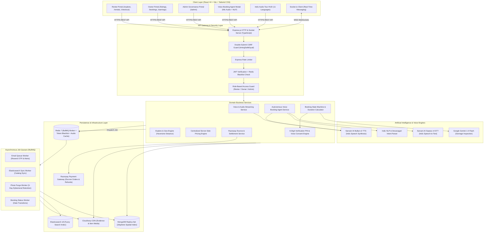
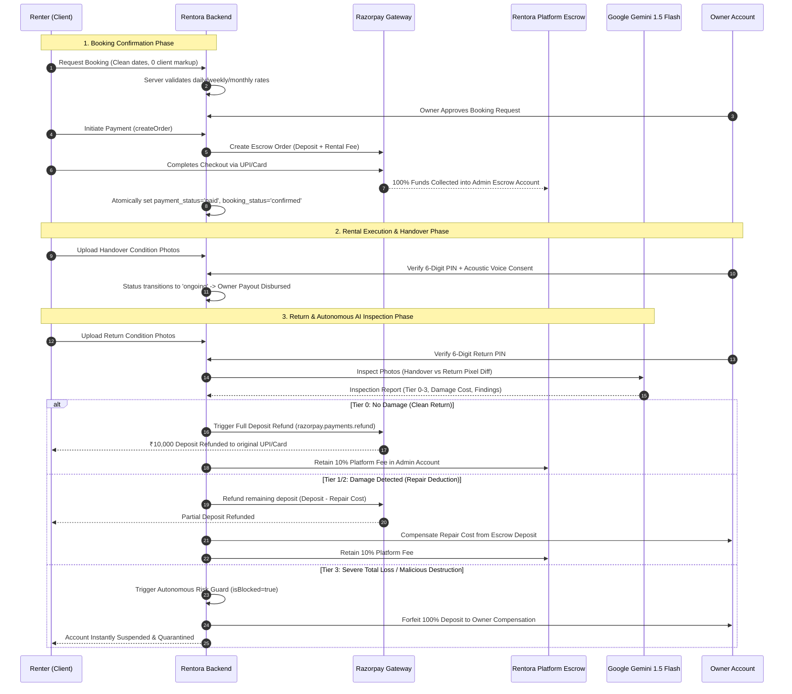
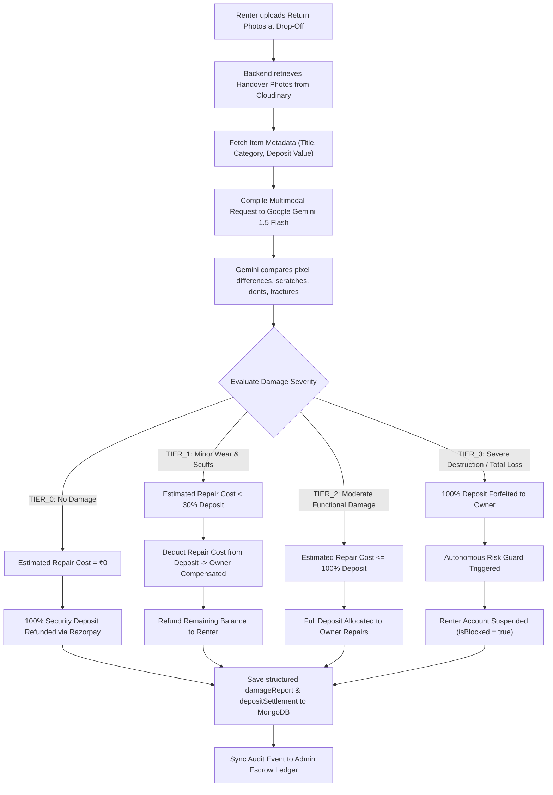
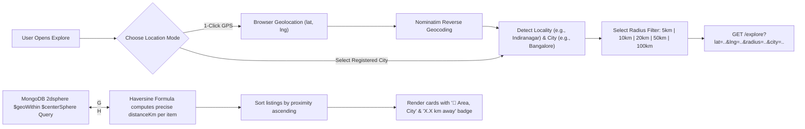
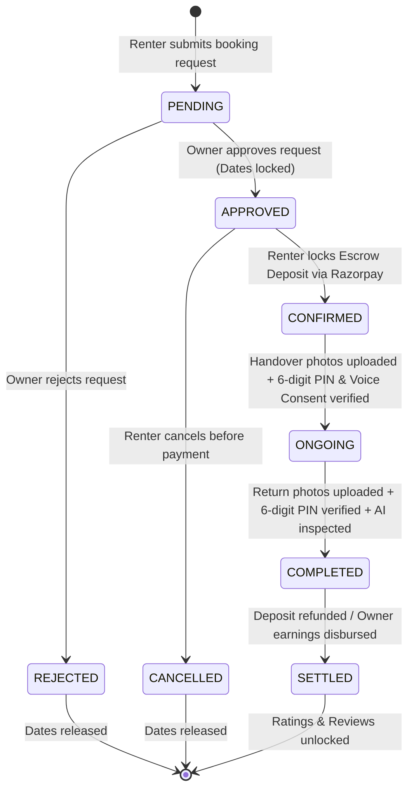

# Rentora — Autonomous Peer-to-Peer Rental Marketplace

> **Rentora** is a production-grade, location-aware peer-to-peer (P2P) equipment rental marketplace engineered with **Node.js, TypeScript, Express, React 18 (Vite), MongoDB, Redis, BullMQ, Socket.io, Elasticsearch, Sarvam AI (Saaras STT + Bulbul TTS), Google Gemini Multimodal AI, and Razorpay Escrow**.

[](https://github.com)
[-purple?style=flat-square)](https://sarvam.ai)
[](https://ai.google.dev)
[](https://razorpay.com)
[](https://elastic.co)
[](https://github.com)

---

## 🌟 Executive Overview

Rentora enables item owners to safely monetize underutilized high-value assets (cameras, drones, power tools, bikes, camping gear, electronics) while giving renters cost-effective, hyper-local short-term access.

Unlike traditional rental platforms that rely on manual forms, insecure cash handshakes, and slow dispute resolution, Rentora introduces:
1. **Autonomous Indic Voice-to-Booking Agent**: Speak naturally in Hinglish, Hindi, or English to search active inventory, validate open dates, and build an escrow booking card in seconds without typing.
2. **Synchronized Indic Audio Dashboard Guides**: Voice-guided onboarding in **11 Indian languages** powered by Sarvam AI Bulbul TTS with real-time DOM element highlighting.
3. **Dual-Layer Anti-Fraud Handover Architecture**: 6-digit cryptographic delivery PIN combined with **acoustic voice consent recording** to eliminate false non-delivery disputes.
4. **Autonomous Escrow Financial Lifecycle**: 100% rental fees and refundable deposits locked in Razorpay Escrow until verified physical inspection.
5. **Multimodal Computer Vision AI Damage Inspection**: Google Gemini 1.5 Flash comparing Handover vs. Return condition photos to detect damage and automate deposit settlements.
6. **Admin Governance & Compliance Portal**: Real-time escrow ledger, transaction arbitration, and one-click user moderation.

---

## 🚀 Key Engineering Differentiators

| Core Engine | Technical Implementation | Purpose & Benefit |
|---|---|---|
| 🎙️ **Autonomous Indic Voice Booking** | Sarvam AI Saaras STT (`saaras:v4`) + Devanagari NLP Parser + Bulbul TTS (`bulbul:v2`) | Rent gear simply by speaking in Hinglish/Hindi/English; auto-matches inventory, validates dates, and builds escrow booking cards |
| 🗣️ **Synchronized Indic Audio Tours** | Sarvam Bulbul TTS Streaming WAV + DOM focus synchronizer (`ring-4 ring-primary`) | 11-language interactive audio walkthroughs for Renters and Owners with real-time on-screen box highlighting |
| 🔐 **Dual-Layer PIN + Voice Handover** | Cryptographic 6-digit PIN + Acoustic Voice Consent Recording stored in audit logs | Eliminates false non-delivery and theft claims; escrow funds unlock only upon mutual in-person verification |
| 🤖 **Multimodal AI Return Inspection** | Google Gemini 1.5 Flash comparing Handover vs Return photos | Autonomous visual damage assessment, repair cost estimation, and dispute elimination |
| 🛡️ **Autonomous Risk Guard** | Real-time AI damage categorization (`TIER_0` to `TIER_3`) | Auto-suspends malicious renters (`isBlocked=true`) on severe damage/total loss without admin intervention |
| 💳 **Platform Escrow & Split Payment** | Razorpay Escrow + Automated Refund API | Security deposits held in platform escrow; 10% platform fee auto-retained by Admin, 90% net payout to Owner |
| 📍 **Hyper-Local GPS & Micro-Locality** | Nominatim Geocoding + Redis Cache + Mongo `2dsphere` + Area Locality | 1-click GPS auto-detection, exact area tagging (e.g., Indiranagar, Alkapuri), and Haversine distance calculations |
| 📸 **Ephemeral Photo Lifecycle** | BullMQ 3-Day Delay Queue + Cloudinary Admin SDK | Handover/Return photo evidence automatically purged after 3 days to preserve privacy and minimize storage |
| 🏛️ **Admin Governance & Audit Ledger** | Real-time Escrow Ledger + User Access Controls | Full platform financial transparency, side-by-side evidence inspection, and one-click user suspension |
| 🔍 **Zero-Downtime Smart Search** | Elasticsearch v8 Fuzzy Search + MongoDB Regex Fallback | High-performance search resilience even if Elasticsearch cluster drops offline |
| 💬 **Real-Time WebSockets** | Socket.io with JWT cookie authentication & isolated booking rooms | Real-time direct chat, typing status, message delivery receipts, and live notification badge updates |
| ⚡ **Resilient Async Queues** | BullMQ + Redis for background jobs with auto-retry | Decoupled email delivery (Resend), ES catalog sync, scheduled status workers, and evidence photo purge |

---

## 🏗️ System Architecture



---

## 🔄 Core Business Lifecycles & Flowcharts

### 1. Autonomous Indic Voice-to-Booking Agent Data Flow

```mermaid
sequenceDiagram
    autonumber
    participant Renter as Renter (Browser Mic)
    participant Modal as VoiceBookingAgentModal
    participant Server as Voice Agent API
    participant Saaras as Sarvam Saaras STT
    participant NLP as Intent and Duration Parser
    participant DB as MongoDB Inventory
    participant Bulbul as Sarvam Bulbul TTS
    participant Checkout as RentCheckout Page

    Renter->>Modal: Tap Mic and Speak - Bhai Sony camera chahiye weekend ke liye
    Modal->>Server: POST /voice/agent with audio/webm and lang
    Server->>Saaras: Transcribe Audio Buffer (saaras v4)
    Saaras-->>Server: Raw Transcript - भाई सोनी कैमरा चाहिए वीकेंड के लिए
    Server->>NLP: Parse Keywords, Hindi Numerals and Duration
    Note over NLP: सोनी = Sony, कैमरा = Camera, वीकेंड = 2 Days
    NLP->>DB: Query Item by title, description or category where isActive is true
    DB-->>Server: Matched Item - Sony A7 IV, ₹1400 per day, ₹5000 deposit
    Server->>Server: Compute Escrow - ₹1400 x 2 days = ₹2800 rent, plus ₹5000 deposit = ₹7800 total
    Server->>Bulbul: Synthesize Hinglish Confirmation Audio (bulbul v2)
    Bulbul-->>Server: Audio Buffer (WAV Base64)
    Server-->>Modal: Return success, bookingCard, audioBase64 and spokenResponse
    Modal->>Renter: Autoplay Voice Reply and Render Booking Card with Date Picker
    Renter->>Modal: Adjust Duration Chip (e.g. 3 Days) and Price Recalculates Dynamically
    Renter->>Modal: Click Proceed to Instant Razorpay Checkout
    alt User is Demo or Guest
        Modal->>Renter: Display Auth Warning (Register, Login or Continue as Demo)
    else User is Registered Renter
        Modal->>Checkout: Navigate to /renter/rent/:id with start, end and days params
    end
---

### 2. Dual-Layer PIN + Acoustic Voice Consent Handover Flow

```mermaid
sequenceDiagram
    autonumber
    participant Renter as Renter (Dashboard)
    participant Owner as Owner (Dashboard)
    participant Server as Handover & PIN Engine
    participant Escrow as Razorpay Escrow Vault
    participant Audit as Immutable Audit Log

    Note over Renter,Owner: Physical Handover at Pickup Location
    Renter->>Server: View Confirmed Booking -> Retrieve 6-Digit Delivery PIN
    Server-->>Renter: Displays PIN: [ 4 | 8 | 2 | 9 | 1 | 7 ]
    Renter->>Owner: Inspects gear & verbally provides PIN
    Owner->>Server: Enter 6-Digit PIN (PINInputModal)
    Owner->>Server: Record Acoustic Voice Statement ("Yes, gear received in good condition")
    Server->>Server: Validate PIN hash & verify attempts < 5
    Server->>Audit: Save Acoustic Consent Audio Blob + SHA256 Handover Checksum
    Server->>Server: Transition booking_status: 'confirmed' -> 'ongoing'
    Server->>Escrow: Unlock Rental Earnings Trigger
    Escrow-->>Owner: 90% Net Rental Revenue transferred to Owner Bank Account
    Server-->>Renter: Handover certified! Rental active.
```

---

### 3. Escrow Split-Payment & AI Deposit Settlement Flow



---

### 4. Multimodal Gemini AI Vision Return Damage Inspection Pipeline



---

### 5. Hyper-Local GPS & Geo-Search Engine Flow



---

### 6. Booking State Machine & Lifecycle Transitions



---

## 🛠️ Complete 24-Feature Marketplace Catalog

### 🧑‍💼 Renter Features (8)
1. **Autonomous Voice-to-Booking Agent**: Speak naturally in Hinglish, Hindi, or English to search active inventory, validate dates, and build an instant booking card without typing.
2. **Interactive Date Picker & Live Escrow Calculator**: Select custom start dates and duration chips (`1D`, `2D`, `3D`, `1 Week`) with real-time recalculation of daily rent and refundable security deposit.
3. **Location-Aware Geospatial Discovery**: Discover verified cameras, drones, tools, and bikes in your immediate neighborhood using browser GPS and MongoDB `2dsphere` spatial indexing.
4. **1-Click Razorpay Escrow Protection**: Rent and refundable deposits are locked safely in an automated escrow vault; owners receive zero funds until verified handover.
5. **6-Digit Delivery Handover PIN**: One-time cryptographic PIN generated inside the renter dashboard. Handover cannot be falsely claimed without this PIN.
6. **Real-Time Live Chat with Owners**: Isolated Socket.io WebSocket rooms for instant gear inquiries, accessory confirmation, and pickup coordination.
7. **Transparent Booking Lifecycle Tracker**: State machine tracking through unambiguous stages: `Requested → Approved → Escrow Locked → Active Rental → Returned → Deposit Refunded`.
8. **Wishlist & Equipment Bookmarking**: Save high-demand cameras and equipment to a personal collection for upcoming shoots and trips.

### 💼 Owner Features (7)
1. **1-Minute Asset Listing & Photo Management**: Cloudinary-backed multi-photo listing wizard with condition tagging, category assignment, and usage guidelines in under 60 seconds.
2. **Custom Rental Rates & Refundable Deposit Controls**: Define tiered daily, weekly, and monthly rates alongside mandatory damage security deposits.
3. **Physical Handover PIN & Acoustic Voice Verification**: Owner enters the renter's secret PIN and captures acoustic voice consent at pickup for 100% dispute elimination.
4. **Automated Escrow Bank Payouts**: Zero-delay revenue disbursement routed directly into the owner's linked bank account once handover verification is certified.
5. **Booking Request Management & Profile Approval**: Full owner autonomy to review renter profiles, requested rental dates, and projected earnings before approval.
6. **Live Earnings & Inventory Utilization Dashboard**: Real-time revenue metrics, active rental counters, equipment utilization percentages, and payout history.
7. **Owner Guided Indic AI Audio Tour**: Synchronized audio guide in 11 Indian languages that points to and highlights dashboard boxes in real time.

### 🛡️ Platform & AI Security Features (9)
1. **Sarvam AI Indic Voice Engine (11 Languages)**: Saaras STT and Bulbul TTS integration supporting Hindi, Gujarati, Marathi, Tamil, Telugu, Bengali, Kannada, Malayalam, Punjabi, Odia, and English.
2. **Dual-Layer Anti-Fraud Handover Architecture**: Cryptographic 6-digit PIN combined with timestamped acoustic voice recording stored in immutable audit trails.
3. **Role-Based Access Control (RBAC) & Layout Isolation**: Strict route guards and layout trees segregating Guest, Renter, Owner, and Admin governance with auto-redirects.
4. **Admin Governance & Escrow Dispute Portal**: Dedicated management portal for platform GMV tracking, escrow dispute arbitration, and item moderation.
5. **Dual Search Engine with Zero-Downtime Fallback**: Elasticsearch fuzzy query cluster with automated instant failover to MongoDB regex search.
6. **Enterprise Multi-Layer Web Security**: HTTP-only cookies, Redis token blacklisting on logout, double CSRF verification, rate limiting, and bcrypt hashing.
7. **BullMQ & Redis Background Task Queues**: Asynchronous worker queues offloading heavy email notifications, photo purging, and expired booking transitions.
8. **Centralized Server-Side Pricing Engine**: Tamper-proof calculator preventing client-side amount manipulation before Razorpay order generation and HMAC signing.
9. **Real-Time WebSocket Engine (Socket.io)**: Sub-second live booking status updates, typing indicators, and instant notifications.

---

## 💻 Tech Stack Summary

### Backend
| Technology | Version / Purpose |
|---|---|
| **Node.js + TypeScript** | Strongly typed, enterprise server runtime |
| **Express.js** | Modular REST API and middleware pipeline |
| **Sarvam AI** | Indic Voice AI: Saaras STT (`saaras:v4`) & Bulbul TTS (`bulbul:v2`) in 11 languages |
| **Google Gemini 1.5 Flash** | Multimodal computer vision AI damage inspection |
| **MongoDB + Mongoose** | Document database with 2dsphere spatial indexing |
| **Redis 7** | BullMQ queue broker, token blacklist, audio cache, and geocoder caching |
| **BullMQ** | Reliable asynchronous job and delay queue management |
| **Razorpay SDK** | Payment orders, escrow payouts, and automated refunds |
| **Elasticsearch v8** | High-performance full-text fuzzy search engine |
| **Socket.io v4** | Bidirectional real-time messaging and notifications |
| **Cloudinary SDK** | Cloud image storage, transformations, and asset purging |
| **Resend** | Transactional email delivery for OTP verification |
| **Sentry APM** | Exception tracking and session performance profiling |
| **Zod** | Runtime schema and payload validation |

### Frontend
| Technology | Version / Purpose |
|---|---|
| **React 18** | Declarative component UI library |
| **Vite 7** | High-speed frontend build tool and dev server |
| **React Router v7** | Client-side routing with nested role-based guards |
| **Tailwind CSS** | Custom responsive styling with dark-mode theme |
| **Web Audio & MediaRecorder API** | In-browser microphone audio capture and WAV playback |
| **Lucide React** | Clean iconography system |
| **Socket.io Client** | Real-time WebSocket connection handling |
| **React Hot Toast** | Dynamic, accessible user feedback alerts |

---

## 📁 Directory Structure

```
Rentora/
├── backend/
│   ├── src/
│   │   ├── config/          # Redis, Socket.io, Mongoose, Cloudinary, Razorpay, Logger config
│   │   ├── controllers/     # HTTP controllers (admin, auth, booking, items, payments, voice)
│   │   ├── middlewares/     # verifyUser, restrictTo, double-submit CSRF, upload, rateLimiter
│   │   ├── models/          # Schemas: User, Item, Booking, Payment, Message, Review, Notification
│   │   ├── payments/        # Strategy Pattern: IPaymentProvider & RazorpayPaymentProvider
│   │   ├── queues/          # BullMQ queue producers (email, status, ES sync, photo purge)
│   │   ├── routes/          # Express route declarations (admin, auth, booking, explore, items, voice)
│   │   ├── service/         # Domain business services (ai, booking, explore, items, payment, voice, voiceAgent)
│   │   ├── utils/           # Geocoder, pricing calculator, AppError
│   │   ├── validators/      # Zod validation schemas
│   │   ├── workers/         # BullMQ queue consumers & background processors
│   │   ├── app.ts           # Express application configuration
│   │   └── server.ts        # Bootstrap entrypoint for HTTP & Socket.io
├── frontend/
│   ├── src/
│   │   ├── assets/          # Static brand icons and images
│   │   ├── components/      # UI components (admin_ui, owner_ui, renter_ui, guest_ui, common)
│   │   │   ├── common/      # VoiceBookingAgentModal, VoiceWelcomeWidget, PINDisplayModal, PINInputModal
│   │   │   ├── owner_ui/    # OwnerVoiceGuide, QuickActions, StatsCard, RentalSection
│   │   │   ├── renter_ui/   # RenterVoiceGuide, ExploreSearchBar, RentCheckoutLayout, RentalCalendar
│   │   ├── context/         # Socket and Auth React contexts
│   │   ├── hooks/           # Custom React hooks (useAuth, apiClient, homeRedirect)
│   │   ├── layouts/         # Layout wrappers (AdminLayout, GuestLayout, OwnerLayout, RenterLayout)
│   │   ├── modals/          # AddItemModal, EditItemModal, AddReviewModal, AuthController, ProfileModal
│   │   ├── pages/           # Pages (guest/Features, admin/AdminDashboard, owner/OwnerDashboard, etc.)
│   │   ├── App.jsx          # Route definitions & ProtectedRoute wrapper
│   │   └── main.jsx         # Client mount entrypoint
```

---

## 🔒 Security Architecture

| Security Layer | Implementation Details |
|---|---|
| **Authentication** | Access Token (15 min) + Refresh Token (7 days) stored in HTTP-Only, SameSite cookies |
| **Token Invalidation** | Redis-backed token blacklist; instant session termination on logout |
| **CSRF Defense** | Double-submit cookie pattern verified with constant-time `crypto.timingSafeEqual` |
| **Autonomous Risk Guard** | Auto-suspension (`isBlocked=true`) triggered by AI on severe item damage |
| **Dual-Layer Handover** | 6-digit numeric PIN with 1-hour TTL + Acoustic Voice Consent Recording stored in audit logs |
| **Input Sanitization** | Strict Zod validation on every request body, query param, and path parameter |
| **Rate Limiting** | `express-rate-limit` prevents brute force on auth, voice, and sensitive endpoints |
| **HTTP Hardening** | Helmet headers (CSP, HSTS, X-Frame-Options) and strict CORS origin checks |
| **Error Monitoring** | Sentry APM integration with automated 500 exception capture and user tracing |

---

## 🔑 Environment Configuration

### Backend Configuration (`backend/.env`)

```env
NODE_ENV=development
PORT=3000
MONGO_URI=mongodb+srv://<username>:<password>@cluster0.mongodb.net/Rentora?retryWrites=true&w=majority
CLIENT_URL=http://localhost:5173

# Authentication & Secrets
JWT_ACCESS_SECRET=your_jwt_access_secret_here
JWT_REFRESH_SECRET=your_jwt_refresh_secret_here
SESSION_SECRET=your_session_secret_here
JWT_ACCESS_EXPIRY=15m
JWT_REFRESH_EXPIRY=7d

# Cache & Queues
REDIS_URL=redis://localhost:6379

# Sarvam AI (Indic Voice Engine: Saaras STT & Bulbul TTS)
SARVAM_API_KEY=your_sarvam_api_key_here

# Google Gemini Multimodal AI (Damage Inspection)
GEMINI_API_KEY=your_gemini_api_key_here

# Payment Gateway (Razorpay Escrow)
RAZORPAY_KEY_ID=rzp_test_your_key_id
RAZORPAY_KEY_SECRET=your_razorpay_secret

# Cloudinary Media Storage
CLOUDINARY_CLOUD_NAME=your_cloud_name
CLOUDINARY_API_KEY=your_cloudinary_key
CLOUDINARY_API_SECRET=your_cloudinary_secret

# Search Engine
ELASTIC_SEARCH_URL=http://localhost:9200
ELASTIC_API_KEY=your_elastic_key

# Transactional Email (Resend)
RESEND_API_KEY=your_resend_api_key
MAIL_USER=your_email@gmail.com

# Error Monitoring
SENTRY_DSN=your_sentry_dsn_url
```

### Frontend Configuration (`frontend/.env`)

```env
VITE_BACKEND_URL=http://localhost:3000/api/v1
VITE_RAZORPAY_KEY_ID=rzp_test_your_key_id
```

---

## ⚡ Installation & Quick Start

### Prerequisites
- **Node.js** v18+ & **npm**
- **MongoDB** (Local instance or MongoDB Atlas cluster)
- **Redis Server** (Port 6379)
- **Elasticsearch v8** *(Optional — MongoDB regex fallback activates automatically if unavailable)*
- **Sarvam AI API Key** *(For Indic Voice Agent and Audio Dashboard Guides)*

### Step 1: Clone Repository
```bash
git clone https://github.com/priyanshuraj20/Rentora.git
cd Rentora
```

### Step 2: Install Dependencies
```bash
# Install backend dependencies
cd backend
npm install

# Install frontend dependencies
cd ../frontend
npm install
```

### Step 3: Populate Environment Variables
Create `.env` in both `backend/` and `frontend/` using the templates provided above.

### Step 4: Run Geocoding Migration (One-Time)
```bash
cd backend
npx ts-node -r tsconfig-paths/register src/scripts/migrateGeoCoordinates.ts
```

### Step 5: Start Development Servers
```bash
# Terminal 1: Backend Server (Port 3000)
cd backend
npm run dev

# Terminal 2: Frontend Client (Port 5173)
cd frontend
npm run dev
```

Visit **`http://localhost:5173`** in your browser.

---

## 🧠 Design Patterns & Best Practices

1. **Clean Layered Architecture**: Clear separation of concerns: `Routes` → `Middlewares` → `Controllers` → `Services` → `Models`.
2. **Strategy Pattern**: Abstracted `IPaymentProvider` allowing seamless swapping of payment gateways (Razorpay, Stripe, etc.).
3. **State Machine Pattern**: Strict, deterministic state transitions for the booking lifecycle preventing invalid statuses or race conditions.
4. **Observer & Event-Driven Architecture**: WebSocket event dispatching decoupled from core business transactions.
5. **Decoupled Queue Architecture**: Non-blocking asynchronous job execution for media purging, emails, and catalog synchronization.
6. **Voice Biometric & Acoustic Auditability**: Cryptographic one-time PINs coupled with immutable acoustic consent recordings for zero-dispute peer handovers.

---

## 📜 License

Distributed under the **MIT License**. Created by [Priyanshu Raj](https://github.com/priyanshuraj20).
