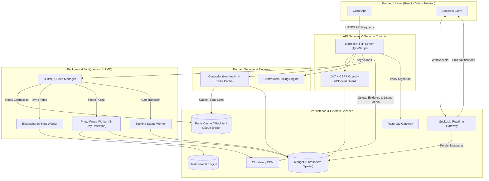
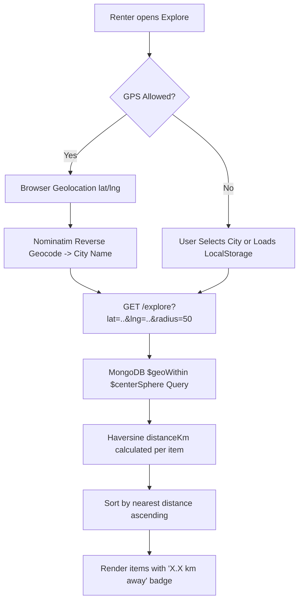
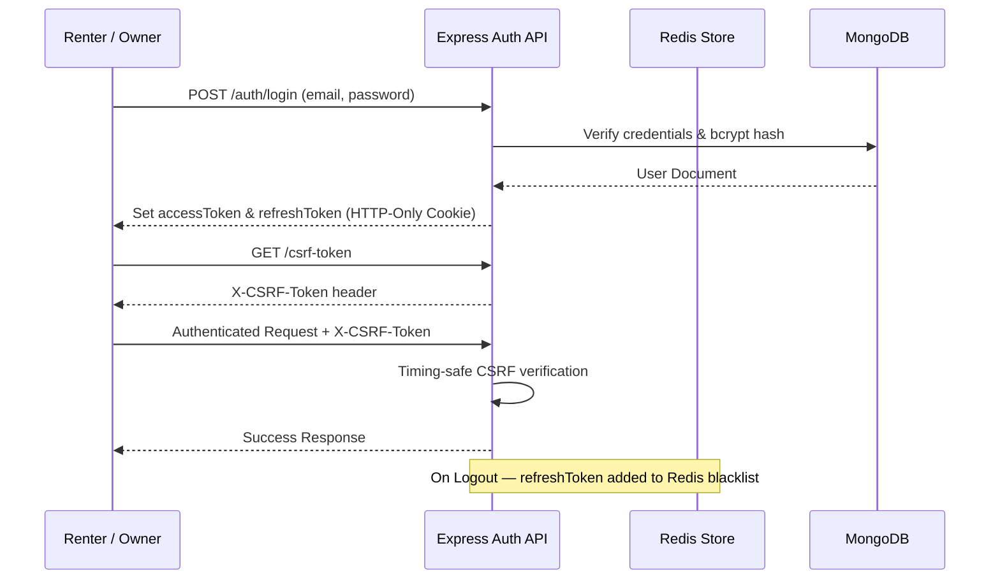
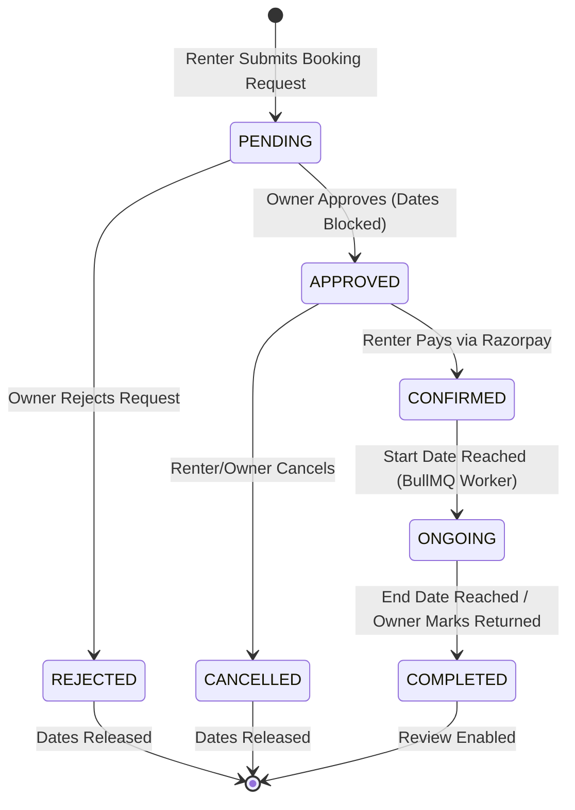
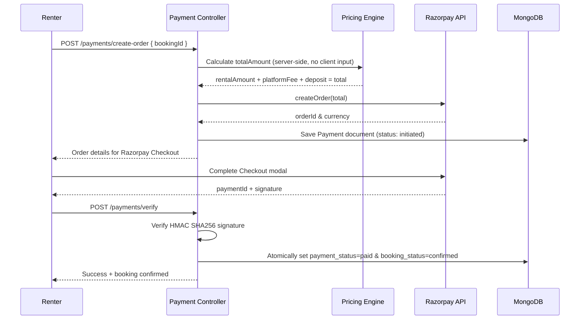
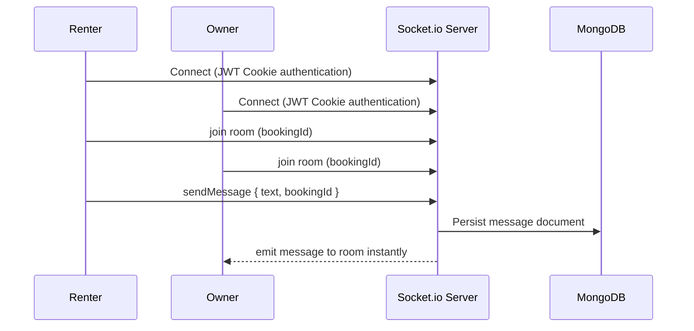
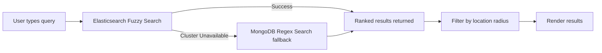
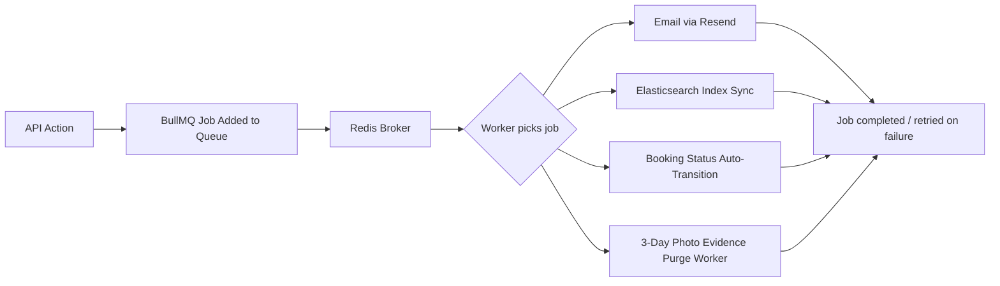
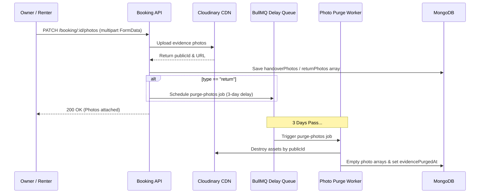

# Rentora — Peer-to-Peer Rental Marketplace

Rentora is a location-aware P2P rental marketplace built with Node.js/TypeScript, React, MongoDB, Redis, BullMQ, Socket.io, Elasticsearch, and Razorpay. It enables item owners to list unused assets (cameras, tools, vehicles, camping gear) and renters to discover and book them from nearby verified users.

## Table of Contents
- [Architecture Overview](#architecture-overview)
- [Key Engineering Components](#key-engineering-components)
- [Feature List](#feature-list)
- [System Architecture Diagram](#system-architecture-diagram)
- [Tech Stack](#tech-stack)
- [Project Structure](#project-structure)
- [Core Business Lifecycles](#core-business-lifecycles)
- [Security Implementation](#security-implementation)
- [Environment Variables](#environment-variables)
- [Installation & Setup](#installation--setup)
- [Design Patterns](#design-patterns)

## Architecture Overview

| Component | Implementation |
|---|---|
| Location-Aware Discovery | Nominatim API geocoding + Redis caching + Haversine formula + MongoDB 2dsphere indexing |
| Photo Evidence Lifecycle | Handover/return condition uploads with 3-day automated Cloudinary purge via BullMQ delay queues |
| Search | Elasticsearch fuzzy search with automatic MongoDB regex fallback |
| Real-Time Chat | JWT-authenticated Socket.io room isolation per booking, with message acknowledgment handling |
| Payments | Server-side amount calculation, HMAC SHA256 signature verification, idempotency guards |
| Async Job Queues | BullMQ + Redis for emails, Elasticsearch sync, evidence purge, and booking status transitions |
| Security | JWT + refresh token blacklist + double CSRF protection + bcrypt + account suspension (`isBlocked`) |
| Architecture | Controller → Service → Model separation with a centralized pricing engine |
| Notifications | Real-time Socket.io delivery with unread badge counts |

## Feature List

### Authentication & User Management
- Email registration with bcrypt password hashing and OTP email verification
- Google OAuth (login + register, flow-aware)
- JWT authentication: access token (15 min) + refresh token (7 days) in HTTP-only cookies
- Refresh token rotation without forced re-login
- Redis-backed token blacklist on logout — invalidated refresh tokens cannot be reused
- Double CSRF protection: secret cookie + `X-CSRF-Token` header with timing-safe comparison
- Role-based access control: Guest, Renter, Owner, Admin, enforced via middleware
- Profile management: name, phone, profile image, address, city, district, state, pincode

### Admin Controls & Account Suspension
- `isBlocked` flag checked during JWT verification; blocked users receive `403 Forbidden` and cannot log in or use the marketplace
- Admin management API: `PATCH /user/:id/block` and `PATCH /user/:id/activate`, restricted to `admin` role

### Photo Evidence & Auto-Purge Lifecycle
- Return condition photos are mandatory before an owner can mark a booking complete (`PATCH /booking/:id/photos`)
- Pickup condition photos are optional, uploaded by renters at handover
- Uploading return photos schedules a BullMQ delay job (`photoPurgeQueue`); after 3 days, `photoPurgeWorker` destroys the Cloudinary assets and clears the DB photo arrays

### Item Listing System (Owners)
- Add/edit/delete items: title, category, description, multiple images (Cloudinary), pricing, deposit, availability, pickup location
- Pause/resume listing visibility on Explore
- New listings automatically inherit the owner's saved profile location

### Location-Aware Discovery (Geospatial Engine)
- Browser Geolocation API with permission handling, or manual city selection
- Radius filter: 5/10/20/50/100 km
- Haversine-calculated distance shown per listing
- MongoDB `2dsphere` index with `$geoWithin $centerSphere` queries
- Location persisted in LocalStorage across navigations

### Smart Search
- Elasticsearch fuzzy search across item title, category, and description
- Automatic MongoDB regex fallback if Elasticsearch is unavailable
- Combined search + location filters
- BullMQ pipeline syncs listing changes to the Elasticsearch index asynchronously

### Wishlist
- Add/remove items, persistent across sessions

### Booking Lifecycle (State Machine)

| Status | Description |
|---|---|
| `PENDING` | Renter sends request |
| `APPROVED` | Owner approves, dates blocked |
| `REJECTED` | Owner or system rejects |
| `CONFIRMED` | Renter completes payment |
| `ONGOING` | Rental started (auto-transitioned by BullMQ worker) |
| `COMPLETED` | Rental returned |
| `CANCELLED` | Cancelled by renter or owner |

- Strict role-based state transitions
- Double-booking prevented via date locking on approval

### Centralized Pricing Engine
- Computes rental amount, platform fee (10%), owner earning, and total
- Single source of truth — client never sends amounts; server always calculates and validates

### Razorpay Payment Integration
- Server-side order creation
- HMAC SHA256 signature verification before confirming booking
- Ownership validation on payment confirm
- Idempotency guards reject duplicate payments
- Atomic transition of booking to `CONFIRMED` on payment success

### Real-Time Chat (Socket.io)
- JWT-authenticated WebSocket connections
- Room-based isolation — each booking has its own chat room
- Live message delivery, unread message handling
- Direct owner-renter messaging

### Notification System
- Real-time Socket.io notifications for booking requests, approvals/rejections, payments, new messages, and listing updates
- Persistent notification bell with unread badge count, mark-all-as-read, direct navigation to the relevant resource

### Ratings & Reviews
- One review per completed booking, enforced server-side
- Star rating (1–5) + optional text
- Item's average rating recalculated in real time after each submission

### Image Upload (Cloudinary)
- Multiple images per listing, optimized CDN delivery, URLs stored in MongoDB

### Background Job Processing (BullMQ + Redis)

| Queue | Purpose |
|---|---|
| Email Queue | OTP, booking accepted/cancelled emails via Resend |
| Elasticsearch Sync | Async index updates on listing create/update/delete |
| Booking Status Worker | Auto-transition bookings to `ongoing`/`completed` by date |
| Photo Purge Queue | 3-day delayed deletion of evidence photos from Cloudinary & DB |

- Automatic retry handling for failed jobs
- Redis-backed concurrency management
- Non-blocking — API responses are never delayed by background work

### Email System (Resend)
- OTP verification, booking accepted, booking cancelled emails
- Extendable to password reset, payment receipts, review reminders

### Owner Dashboard
- Overview of total listings, active bookings, pending requests
- Earnings analytics: gross earnings, platform fees, net payouts
- Inventory management with pause/resume, booking approval workflow

### Renter Dashboard
- Active rental tracking, rental history, wishlist management, message inbox, review management

## System Architecture Diagram



## Tech Stack

### Backend
| Technology | Purpose |
|---|---|
| Node.js + TypeScript | Runtime & type safety |
| Express.js | HTTP server framework |
| MongoDB + Mongoose | Primary database with 2dsphere spatial indexing |
| Redis | Refresh token blacklist, BullMQ broker |
| BullMQ | Background job queue processing |
| Elasticsearch v8 | Full-text fuzzy search engine |
| Socket.io v4 | Real-time bidirectional WebSocket communication |
| Razorpay Node SDK | Payment gateway integration |
| Cloudinary Node SDK | Image upload and CDN delivery |
| Resend | Transactional email delivery |
| Zod | Schema validation |
| bcrypt | Password hashing |
| Helmet + CORS | HTTP security headers |
| express-rate-limit | API rate limiting |

### Frontend
| Technology | Purpose |
|---|---|
| React 18 + Vite | UI framework with fast HMR |
| React Router v7 | Client-side routing with protected routes |
| Tailwind CSS | Utility-first responsive styling |
| Lucide React | Icon system |
| Socket.io Client | WebSocket connections |
| React Hot Toast | User feedback notifications |
| Browser Geolocation API | GPS location detection |

## Project Structure

```
Rentora/
├── backend/
│   ├── src/
│   │   ├── config/          # Redis, Socket.io, Mongoose, Cloudinary, Razorpay config
│   │   ├── controllers/     # HTTP request/response orchestrators
│   │   ├── middlewares/     # Auth guards (verifyUser, restrictTo), CSRF, global error handler
│   │   ├── models/          # Mongoose schemas (User, Item, Booking, Message, Review, Notification)
│   │   ├── payments/        # Strategy pattern (IPaymentProvider) + Razorpay implementation
│   │   ├── queues/          # BullMQ queue producers (email, bookingStatus, elasticSync)
│   │   ├── routes/          # Express API route declarations
│   │   ├── scripts/         # Idempotent migration scripts (migrateGeoCoordinates.ts)
│   │   ├── service/         # Domain business logic (explore, items, booking, payment, review, notification)
│   │   ├── utils/           # Geocoder, pricing calculator, AppError, async wrapper, token utilities
│   │   ├── validators/      # Zod validation schemas
│   │   ├── workers/         # BullMQ consumer workers (email, booking status, ES sync)
│   │   ├── app.ts           # Express application init & middleware stack
│   │   └── server.ts        # HTTP & Socket.io server bootstrap
├── frontend/
│   ├── src/
│   │   ├── assets/          # Static brand logos and imagery
│   │   ├── components/      # UI components (Explore, ItemCards, Navbar, Dashboards, Modals)
│   │   ├── context/         # React contexts (SocketContext)
│   │   ├── hooks/           # Custom hooks (useAuth, homeRedirect, apiClient)
│   │   ├── layouts/         # Page layout wrappers (GuestLayout, RenterLayout, OwnerLayout)
│   │   ├── modals/          # Modal components (AddReviewModal, AuthModal)
│   │   ├── pages/           # Page views (Explore, Features, ItemDetails, Dashboard, Messages, Checkout)
│   │   ├── App.jsx          # Router & protected route guards
│   │   └── main.jsx         # Vite entrypoint
```

## Core Business Lifecycles

### 1. Location-Aware Discovery & Geo-Search


### 2. Authentication & Security Flow


### 3. Booking Lifecycle & State Machine


### 4. Payment Integration (Razorpay)


### 5. Real-Time Chat (Socket.io)


### 6. Search with Zero-Downtime Fallback


### 7. BullMQ Background Job Flow


### 8. Photo Evidence Upload & Automated Purge Lifecycle


## Security Implementation

| Layer | Implementation |
|---|---|
| Password Storage | bcrypt with salt rounds |
| Session Tokens | JWT access (15 min) + refresh (7 days) in HTTP-only, SameSite cookies |
| Token Invalidation | Redis-backed refresh token blacklist on logout |
| CSRF Protection | Double-submit cookie pattern with `timingSafeEqual` comparison |
| Input Validation | Zod schema validation on all routes |
| Rate Limiting | `express-rate-limit` on auth and sensitive endpoints |
| HTTP Headers | Helmet middleware (CSP, HSTS, X-Frame-Options) |
| Ownership Guards | Every mutation checks user ownership before proceeding |
| Role Enforcement | `restrictTo(role)` middleware on every protected route |
| Account Guards | `isBlocked` middleware check returning `403 Forbidden` for suspended users |
| XSS Safe Inputs | All user inputs sanitized before storage |

## Environment Variables

`backend/.env`:
```env
NODE_ENV=development
PORT=3000
MONGO_URI=mongodb://localhost:27017/rentora
CLIENT_URL=http://localhost:5173
JWT_ACCESS_SECRET=your_jwt_access_secret
JWT_REFRESH_SECRET=your_jwt_refresh_secret
JWT_ACCESS_EXPIRY=15m
JWT_REFRESH_EXPIRY=7d
SESSION_SECRET=your_session_secret
RAZORPAY_KEY_ID=rzp_test_your_key_id
RAZORPAY_KEY_SECRET=your_razorpay_secret
ELASTIC_SEARCH_URL=http://localhost:9200
ELASTIC_API_KEY=your_elastic_api_key
CLOUDINARY_CLOUD_NAME=your_cloud_name
CLOUDINARY_API_KEY=your_cloudinary_key
CLOUDINARY_API_SECRET=your_cloudinary_secret
RESEND_API_KEY=your_resend_api_key
REDIS_URL=redis://localhost:6379
```

`frontend/.env`:
```env
VITE_BACKEND_URL=http://localhost:3000/api/v1
VITE_RAZORPAY_KEY_ID=rzp_test_your_key_id
```

## Installation & Setup

### Prerequisites
- Node.js v18+ & npm
- MongoDB (local or Atlas)
- Redis server (port 6379)
- Elasticsearch v8 (optional — MongoDB fallback activates automatically if offline)

### 1. Clone & Install Dependencies
```bash
git clone https://github.com/priyanshuraj20/Rentora.git
cd Rentora
# Backend
cd backend && npm install
# Frontend
cd ../frontend && npm install
```

### 2. Configure Environment Variables
Copy and fill in the `.env` files as described above.

### 3. Run Geocoding Data Migration (one-time, for existing data)
```bash
cd backend
npx ts-node -r tsconfig-paths/register src/scripts/migrateGeoCoordinates.ts
```

### 4. Start Development Servers
```bash
# Backend (in one terminal)
cd backend && npm run dev
# Frontend (in another terminal)
cd frontend && npm run dev
```

App runs at `http://localhost:5173`.

## Design Patterns

| Pattern | Where Applied |
|---|---|
| Service Layer | Business logic decoupled from HTTP controllers |
| Strategy Pattern | `IPaymentProvider` interface for payment gateways |
| State Machine | Booking lifecycle state transitions |
| Repository Pattern | MongoDB queries abstracted into service functions |
| Observer Pattern | Socket.io event-driven notification system |
| Queue-Based Processing | BullMQ async job execution |

## License

Distributed under the MIT License. See `LICENSE` for details.
