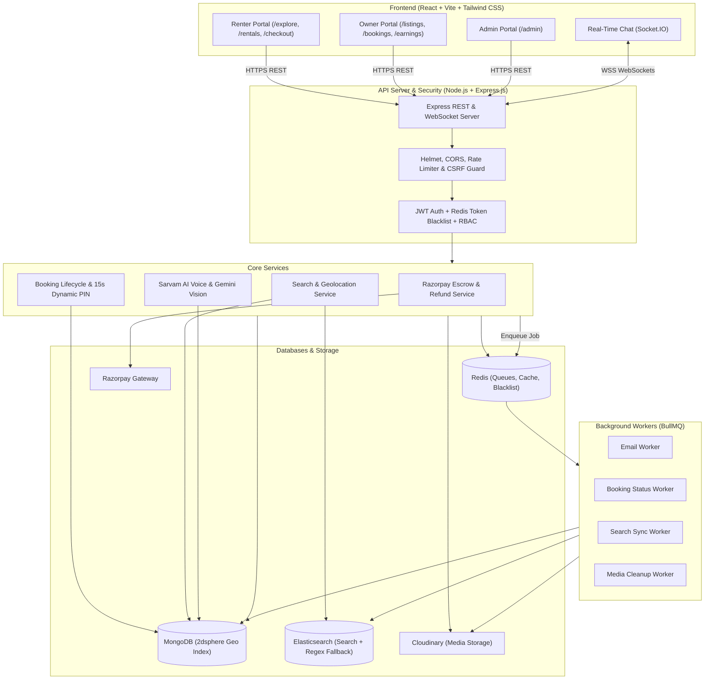
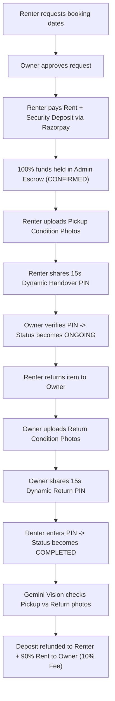
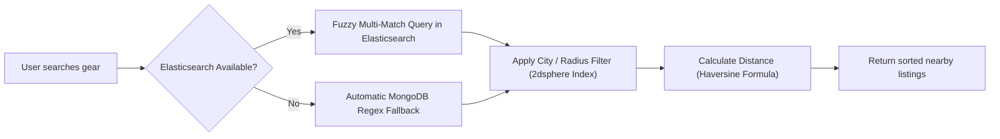
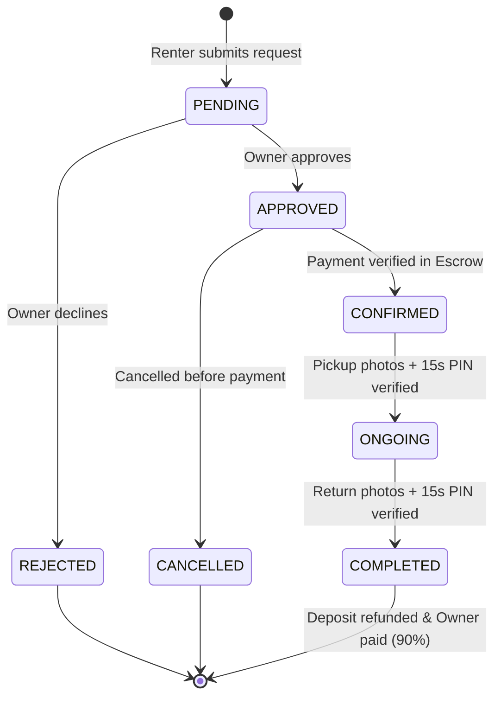

# Rentora — Peer-to-Peer Rental Marketplace

> **Rentora** is a full-stack peer-to-peer rental marketplace built with **Node.js, Express.js, React, MongoDB, Redis, BullMQ, Socket.IO, Elasticsearch, and Razorpay**.

[](https://github.com/priyanshuraj20/Rentora)
[](https://github.com/priyanshuraj20/Rentora)
[](https://github.com/priyanshuraj20/Rentora)
[](https://github.com/priyanshuraj20/Rentora)
[](https://github.com/priyanshuraj20/Rentora)

---

## Overview

Rentora lets equipment owners earn from unused items (cameras, drones, tools, bikes) while helping renters find and book gear nearby safely.

### Core Highlights
- **Marketplace Architecture**: Complete owner and renter workflows with Elasticsearch + MongoDB geolocation discovery, booking lifecycle management, Socket.IO real-time chat, and Razorpay Escrow payments.
- **Asynchronous Processing**: BullMQ + Redis background workers handle booking status updates, OTP/email delivery, search index sync, and scheduled media cleanup without blocking API requests.
- **Authentication & Authorization**: JWT authentication in HTTP-only cookies, Redis-backed token blacklisting on logout, Google OAuth, Role-Based Access Control (RBAC), double-submit CSRF protection, and rate limiting.
- **Security Hardening**: Prevented cross-booking payment replay attacks and fixed IDOR vulnerabilities in booking cancellation, paired with server-side pricing and a photo-gated 15-second dynamic PIN handover system.
- **AI Features**: Indic voice search & audio guides (Sarvam AI) and automated pickup-vs-return condition inspection (Google Gemini Vision).

---

## System Architecture



---

## Core Workflows

### 1. Booking, Handover & Return Flow



---

### 2. Geolocation & Search Flow



---

### 3. Booking State Machine



---

## Key Features

### Marketplace & Real-Time Chat
- **Location-Aware Discovery**: Search gear using browser GPS (`2dsphere` spatial index + Haversine distance) and Elasticsearch fuzzy search with automatic MongoDB fallback.
- **Socket.IO Messaging**: Live owner-renter chat with conversation search, quick-reply chips, and message/conversation deletion.
- **Full Booking Lifecycle**: Date conflict checks, server-side pricing calculator, and live status sync over WebSockets.

### Escrow Payments & Verification
- **Admin Escrow**: Renter pays rental cost + refundable security deposit upfront. Nothing is released to the owner until the item is safely returned.
- **Photo-Gated 15s Dynamic PIN**: Renter uploads pickup photos to unlock the 15-second Handover PIN; Owner uploads return photos (enforced server-side) to unlock the 15-second Return PIN.
- **Automated Settlement**: After return inspection, the security deposit is refunded via Razorpay and 90% of the rental fee (10% platform fee) is credited to the owner.

### Background Processing (BullMQ + Redis)
- **Email Worker**: Sends booking and OTP emails asynchronously.
- **Booking Status Worker**: Handles scheduled booking state transitions.
- **Search Sync Worker**: Keeps Elasticsearch synced when items are created, updated, or deleted.
- **Media Cleanup Worker**: Automatically deletes temporary condition photos after 3 days.

### Authentication & Security Hardening
- **Auth & Sessions**: Access + Refresh JWT tokens in HTTP-only cookies, Redis token blacklisting on logout, and Google OAuth 2.0.
- **RBAC & CSRF**: Role guards (`renter`, `owner`, `admin`), double-submit CSRF verification, Helmet headers, Zod input validation, and route-level rate limiting.
- **Payment Replay Fix**: Bound Razorpay `orderId` strictly to the matching `bookingId` and `payment` record so a single payment cannot be replayed across bookings.
- **IDOR Fix**: Enforced strict ownership checks (`renter_id` / `owner_id`) on booking cancellation, photo uploads, and PIN endpoints.

---

## Tech Stack

| Layer | Technologies |
|---|---|
| **Backend** | Node.js, Express.js, Mongoose, Zod, Winston, Sentry |
| **Database & Cache** | MongoDB (`2dsphere`), Redis (`ioredis`), Elasticsearch |
| **Queues & Realtime** | BullMQ, Socket.IO |
| **Payments & Auth** | Razorpay API, JWT, Google OAuth 2.0 (Passport), Bcrypt |
| **Frontend** | React, Vite, Tailwind CSS, React Router, Lucide Icons |
| **AI & Media** | Sarvam AI (STT/TTS), Google Gemini Vision, Cloudinary, Resend |

---

## Directory Structure

```text
Rentora/
├── backend/
│   └── src/
│       ├── config/          # DB, Redis, Elasticsearch, Socket.IO, Sentry, Cloudinary
│       ├── controllers/     # Auth, Booking, Explore, Item, Payment, Message, Admin
│       ├── middlewares/     # JWT verify, RBAC, CSRF, Rate Limiter, Error Handler
│       ├── models/          # User, Item, Booking, Payment, Message, Review, Notification
│       ├── payments/        # Razorpay payment & refund provider
│       ├── queues/          # BullMQ queue definitions
│       ├── routes/          # REST API routes
│       ├── service/         # Core business logic & pricing engine
│       ├── validators/      # Zod request validation schemas
│       └── workers/         # BullMQ background workers
└── frontend/
    └── src/
        ├── components/      # Portal UI, PIN modals, Voice guide, Search bar
        ├── context/         # AuthContext, SocketContext
        ├── layouts/         # Guest, Renter, Owner, Admin layouts
        ├── pages/           # Explore, Rentals, Bookings, Earnings, Messages, Admin
        └── utils/           # API client with CSRF & silent token refresh
```

---

## Quick Start

### 1. Clone & Install
```bash
git clone https://github.com/priyanshuraj20/Rentora.git
cd Rentora

cd backend && npm install
cd ../frontend && npm install
```

### 2. Environment Variables
Create `backend/.env`:
```env
PORT=3000
NODE_ENV=development
MONGO_URI=your_mongodb_uri
REDIS_URL=redis://localhost:6379
CLIENT_URL=http://localhost:5173

JWT_ACCESS_SECRET=your_access_secret
JWT_REFRESH_SECRET=your_refresh_secret
QR_TOKEN_SECRET=your_qr_secret
SESSION_SECRET=your_session_secret

RAZORPAY_KEY_ID=your_razorpay_key_id
RAZORPAY_KEY_SECRET=your_razorpay_secret

CLOUDINARY_CLOUD_NAME=your_cloud_name
CLOUDINARY_API_KEY=your_api_key
CLOUDINARY_API_SECRET=your_api_secret

# Optional (falls back to MongoDB search if omitted)
ELASTIC_SEARCH_URL=
ELASTIC_API_KEY=

# Optional AI & Monitoring
GEMINI_API_KEY=
SARVAM_API_KEY=
SENTRY_DSN=
```

Create `frontend/.env`:
```env
VITE_BACKEND_URL=http://localhost:3000/api/v1
VITE_RAZORPAY_KEY_ID=your_razorpay_key_id
```

### 3. Run Locally
```bash
# Terminal 1 - Backend
cd backend && npm run dev

# Terminal 2 - Frontend
cd frontend && npm run dev
```
Open `http://localhost:5173`.

---

## License

MIT License — Built by [Priyanshu Raj](https://github.com/priyanshuraj20).
