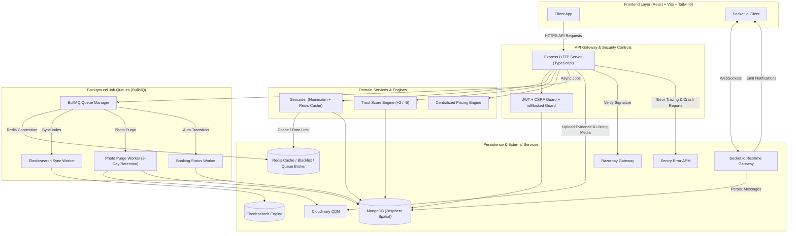
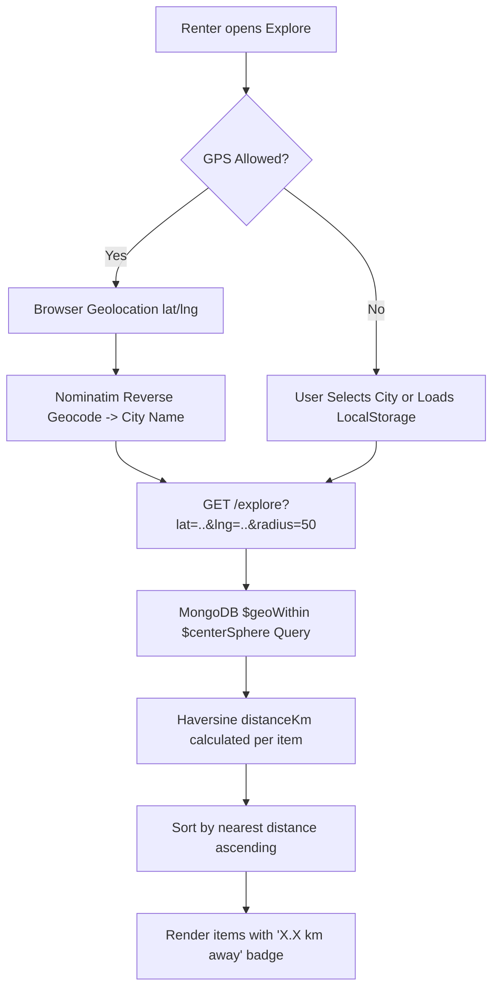
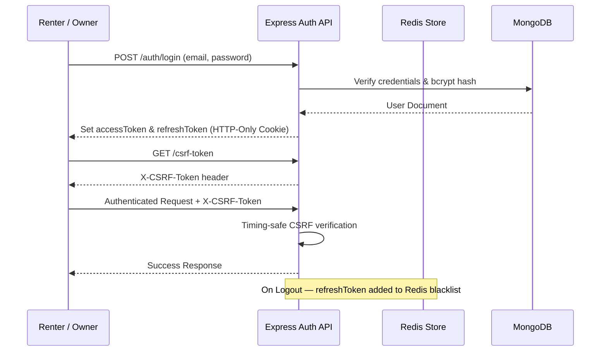
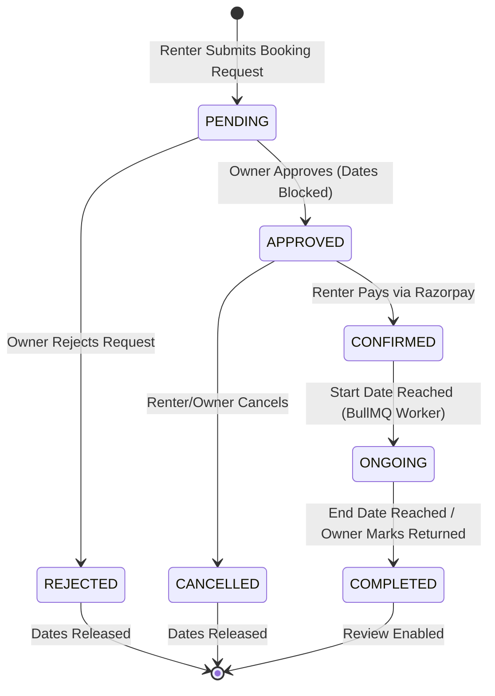
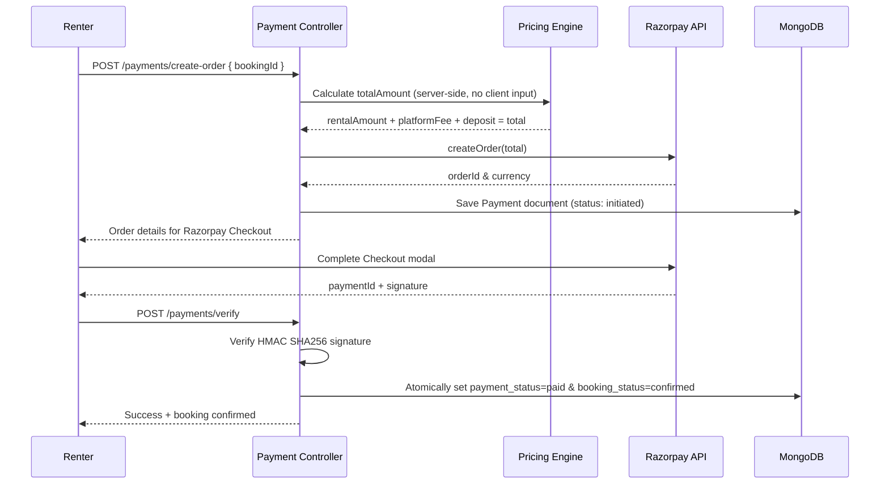
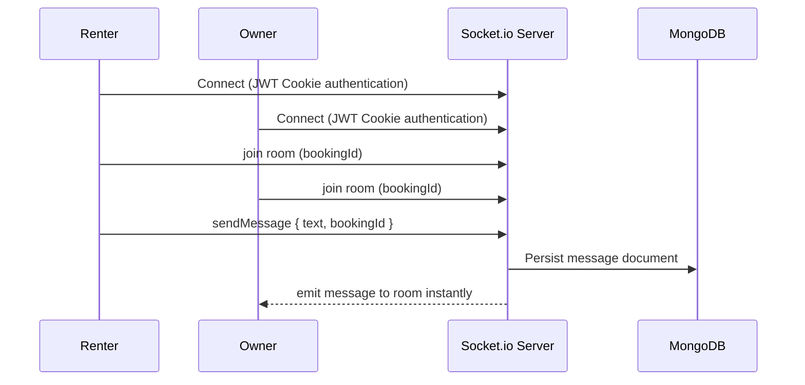
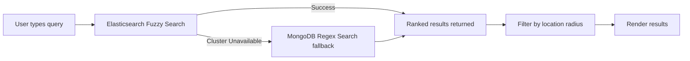
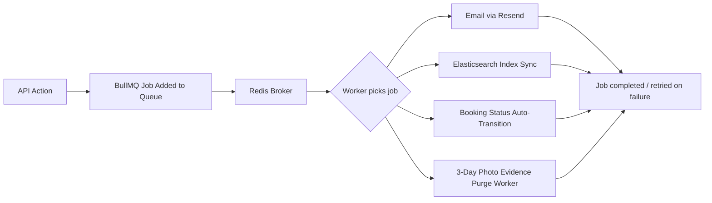
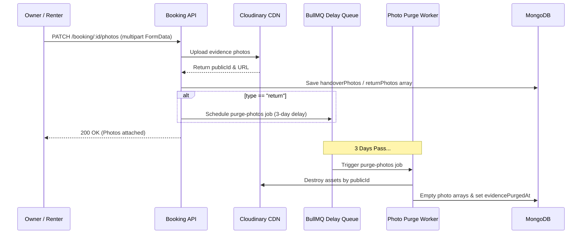
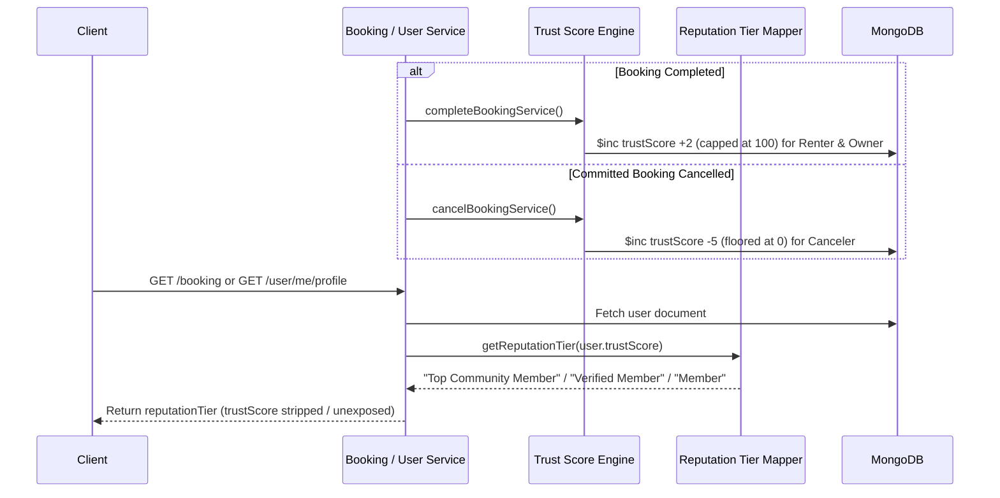

# Rentora — Production-Grade Peer-to-Peer Rental Marketplace

> **Not just a CRUD project.** Rentora is an end-to-end, location-aware P2P rental marketplace with enterprise security, real-time WebSockets, background job queues, zero-downtime search, Razorpay payments, and a clean production architecture.

[](https://github.com)
[](https://github.com)
[](https://github.com)

---

## 📋 Table of Contents
- [Overview](#-overview)
- [What Makes Rentora Different](#-what-makes-rentora-different)
- [Full Feature List](#-full-feature-list)
- [System Architecture](#-system-architecture)
- [Tech Stack](#-tech-stack)
- [Project Structure](#-project-directory-structure)
- [Core Business Lifecycles](#-core-business-lifecycles)
- [UI & Frontend Features](#-ui--frontend-features)
- [Security Implementation](#-security-implementation)
- [Environment Variables](#-environment-variables)
- [Installation & Setup](#-installation--setup)
- [License](#-license)

---

## 🌟 Overview

Rentora enables item owners to monetize unused assets while giving renters affordable, short-term access to cameras, tools, vehicles, bikes, camping gear, and more — from verified neighbors nearby.

Built with **Node.js + TypeScript**, **React (Vite)**, **MongoDB**, **Redis**, **BullMQ**, **Socket.io**, **Elasticsearch**, and **Razorpay**, Rentora is architected for reliability, scale, and maintainability.

---

## 🚀 What Makes Rentora Different

These are the top engineering highlights that separate Rentora from a standard college project:

| Feature | Implementation |
|---|---|
| 📍 **Location-Aware Discovery** | Nominatim API geocoding + Redis caching + Haversine formula + MongoDB 2dsphere indexing |
| 🛡️ **Trust & Reputation Engine** | Internal Trust Score tracking (+2 completion, -5 cancellation penalty) & public `reputationTier` mapping |
| 📸 **Ephemeral Photo Evidence** | Handover/Return condition uploads with 3-day automated Cloudinary asset purge via BullMQ delay queues |
| 🔍 **Zero-Downtime Search** | Elasticsearch fuzzy search with automatic MongoDB regex fallback |
| 💬 **Real-Time Chat** | JWT-authenticated Socket.io room isolation per booking + message acknowledgment handling |
| 💳 **Secure Payments** | Server-side amount calculation, HMAC SHA256 verification, idempotency |
| ⚡ **Async Job Queues** | BullMQ + Redis for emails, ES sync, evidence purge, and automated booking transitions |
| 🔒 **Enterprise Security** | JWT + Refresh Token Blacklist + Double CSRF + bcrypt + Account Suspension (`isBlocked`) |
| 📊 **Error Monitoring** | Sentry APM integration with automated 500 error capture and user context binding |
| 🏛 **Clean Architecture** | Controller → Service → Model separation, centralized pricing engine |
| 🔔 **Live Notifications** | Real-time Socket.io notification delivery with unread badge counts |

---

## ✨ Full Feature List

### 👤 Authentication & User Management

- **Email Registration** with bcrypt password hashing and OTP email verification
- **Google OAuth** (Login + Register, flow-aware)
- **JWT Authentication**: Access Token (15 min) + Refresh Token (7 days) in HTTP-Only cookies
- **Refresh Token Rotation**: New access token issued without forcing re-login
- **Token Blacklist**: Redis-backed logout that invalidates refresh tokens — stolen tokens cannot be reused
- **Double CSRF Protection**: Secret cookie + `X-CSRF-Token` header with timing-safe comparison
- **Role-Based Access Control**: Guest, Renter, Owner, Admin roles with strict middleware guards
- **Profile Management**: Name, phone, profile image, address, city, district, state, pincode

### 🛡️ Admin Controls & Account Suspension

- **Account Block Middleware**: `isBlocked` flag checked during JWT verification; blocked users receive a `403 Forbidden` response and are prevented from logging in or using the marketplace
- **Admin Management API**: `PATCH /user/:id/block` and `PATCH /user/:id/activate` restricted to `admin` role

### 🛡️ Trust Score & Reputation System

- **Automated Trust Scoring**: Internal user score (0–100 range) automatically updated based on rental lifecycle performance:
  - `+2` score increment for both renter and owner upon successful booking completion (capped at 100)
  - `-5` score penalty for canceling a committed (`APPROVED` / `CONFIRMED`) booking (floored at 0)
- **Public Reputation Abstraction**: Unexposed raw score; server maps `trustScore` to public badges (`Top Community Member`, `Verified Member`, `Member`) returned in `reputationTier`

### 📸 Photo Evidence & Auto-Purge Lifecycle

- **Mandatory Return Condition Upload**: Owner cannot mark booking completed until return condition photos are uploaded via `PATCH /booking/:id/photos`
- **Optional Pickup Condition Upload**: Renters can upload handover condition photos at pickup
- **Automated 3-Day Asset Purge Queue**: Uploading return condition photos schedules a BullMQ delay job (`photoPurgeQueue`). After 3 days, `photoPurgeWorker` automatically destroys the Cloudinary assets and clears DB photo arrays to optimize storage overhead

### 📊 Error Tracking & APM (Sentry)

- **Automated Exception Capture**: `Sentry.setupExpressErrorHandler` captures uncaught 500 runtime exceptions & unhandled promise rejections
- **User Context Tracing**: `Sentry.setUser({ id: userId })` attached during JWT verification for session-correlated crash reporting
- **Environment Isolation**: Configured DSN with environment-aware sample rates (`tracesSampleRate`)

### 📦 Item Listing System (Owners)

- **Add Item**: Title, category, description, multiple images (Cloudinary CDN), pricing, deposit, availability, pickup location
- **Edit Item**: All fields fully editable
- **Delete Item**: Soft business validation before removal
- **Pause Listing**: Temporarily hide from Explore (great for vacations, maintenance, personal use)
- **Resume Listing**: Instantly re-publish to marketplace
- **Auto Location Inheritance**: New listings automatically inherit owner's saved profile location — no manual re-entry

### 📍 Location-Aware Discovery (Geospatial Engine)

- **Automatic GPS Detection**: Browser Geolocation API with permission handling
- **Manual City Selection**: User can override to any city (e.g., Ahmedabad → Ranchi → Delhi)
- **Radius Filter**: Choose 5km / 10km / 20km / 50km / 100km dynamically
- **Distance Display**: Exact Haversine-calculated distance shown per listing (e.g., `4.3 km away`)
- **MongoDB GeoSpatial**: `2dsphere` index + `$geoWithin $centerSphere` queries
- **LocalStorage Caching**: Location persists across page navigations

### 🔍 Smart Search System

- **Elasticsearch**: High-performance fuzzy search across item title, category, and description
- **Zero-Downtime Fallback**: If Elasticsearch is unavailable, MongoDB regex search activates automatically
- **Combined Filters**: Search + Location (e.g., *"Camera within 20km"*)
- **BullMQ Sync Pipeline**: All listing changes are queued for async Elasticsearch index updates

### ❤️ Wishlist

- Add / Remove items from wishlist
- Persistent across sessions
- Compare and rent anytime

### 📅 Booking Lifecycle (State Machine)

| Status | Description |
|---|---|
| `PENDING` | Renter sends request |
| `APPROVED` | Owner approves, dates blocked |
| `REJECTED` | Owner or system rejects |
| `CONFIRMED` | Renter completes payment |
| `ONGOING` | Rental started (auto-transitioned by BullMQ worker) |
| `COMPLETED` | Rental returned |
| `CANCELLED` | Cancelled by renter or owner |

- Strict role-based state transitions
- Prevents double-booking via date locking on approval

### 💰 Centralized Pricing Engine

- Automatically computes: rental amount, platform fee (10%), owner earning, and total
- **Single source of truth** — client never sends amounts, server always calculates and validates

### 💳 Razorpay Payment Integration

- Server-side Razorpay order creation
- **HMAC SHA256 signature verification** before confirming booking
- Ownership validation on payment confirm
- Idempotency guards — duplicate payments rejected
- Atomically transitions booking to `CONFIRMED` on payment success

### 💬 Real-Time Chat (Socket.io)

- **JWT-authenticated** WebSocket connections
- **Room-based isolation** — each booking has its own chat room
- Live message delivery with automatic scrolling
- Unread message handling
- Owner ↔ Renter direct messaging

### 🔔 Notification System

Real-time notifications via Socket.io for:
- Booking request received
- Booking approved / rejected
- Payment completed
- New message received
- Listing updates

- Persistent notification bell with unread badge count
- Mark all as read
- Direct navigation to relevant resource on click

### ⭐ Ratings & Reviews

- Renters can rate and review items after a completed booking
- One review per booking (enforced server-side)
- Star rating (1–5) + optional text review
- Real-time average rating recalculated on `Item` document after every submission
- Ratings displayed across Explore, Search, and Item Detail pages

### 📷 Image Upload (Cloudinary)

- Multiple images per listing
- Optimized delivery via Cloudinary CDN
- Automatic URL storage in MongoDB

### ⚡ Background Job Processing (BullMQ + Redis)

| Queue | Purpose |
|---|---|
| Email Queue | OTP, booking accepted/cancelled emails via Resend |
| Elasticsearch Sync | Async index updates on listing create/update/delete |
| Booking Status Worker | Auto-transition bookings to `ongoing` / `completed` by date |
| Photo Purge Queue | 3-day delayed auto-deletion of evidence photos from Cloudinary & DB |

- Automatic retry handling for failed jobs
- Redis-backed concurrency management
- Non-blocking — API responses are never delayed by background work

### 📧 Email System (Resend)

Currently sends:
- OTP verification email
- Booking accepted notification
- Booking cancelled notification

Easily extendable to: password reset, payment receipt, review reminders.

### 📊 Owner Dashboard

- Overview of total listings, active bookings, pending requests
- **Earnings Analytics**: Gross earnings, platform fees, net payouts
- Inventory management with pause/resume controls
- Booking approval workflow

### 🎯 Renter Dashboard

- Active rental tracking
- Rental history
- Wishlist management
- Message inbox
- Review management

---

## 🏗️ System Architecture



---

## 🛠️ Tech Stack

### Backend
| Technology | Purpose |
|---|---|
| Node.js + TypeScript | Runtime & type safety |
| Express.js | HTTP server framework |
| MongoDB + Mongoose | Primary database with 2dsphere spatial indexing |
| Redis | Refresh token blacklist, BullMQ broker |
| BullMQ | Background job queue processing |
| Elasticsearch v8 | Full-text fuzzy search engine |
| Socket.io v4 | Real-time bidirectional WebSocket communication |
| @sentry/node | Production APM, 500 error capture & user context tracing |
| Razorpay Node SDK | Payment gateway integration |
| Cloudinary Node SDK | Image upload and CDN delivery |
| Resend | Transactional email delivery |
| Zod | Schema validation |
| bcrypt | Password hashing |
| Helmet + CORS | HTTP security headers |
| express-rate-limit | API rate limiting |

### Frontend
| Technology | Purpose |
|---|---|
| React 18 + Vite | UI framework with fast HMR |
| React Router v7 | Client-side routing with protected routes |
| Tailwind CSS | Utility-first responsive styling |
| Lucide React | Icon system |
| Socket.io Client | WebSocket connections |
| React Hot Toast | User feedback notifications |
| Browser Geolocation API | GPS location detection |

---

## 📁 Project Directory Structure

```
Rentora/
├── backend/
│   ├── src/
│   │   ├── config/          # Redis, Socket.io, Mongoose, Cloudinary, Razorpay config
│   │   ├── controllers/     # HTTP request/response orchestrators
│   │   ├── middlewares/     # Auth guards (verifyUser, restrictTo), CSRF, global error handler
│   │   ├── models/          # Mongoose schemas (User, Item, Booking, Message, Review, Notification)
│   │   ├── payments/        # Strategy pattern (IPaymentProvider) + Razorpay implementation
│   │   ├── queues/          # BullMQ queue producers (email, bookingStatus, elasticSync)
│   │   ├── routes/          # Express API route declarations
│   │   ├── scripts/         # Idempotent migration scripts (migrateGeoCoordinates.ts)
│   │   ├── service/         # Domain business logic (explore, items, booking, payment, review, notification)
│   │   ├── utils/           # Geocoder, pricing calculator, AppError, async wrapper, token utilities
│   │   ├── validators/      # Zod validation schemas
│   │   ├── workers/         # BullMQ consumer workers (email, booking status, ES sync)
│   │   ├── app.ts           # Express application init & middleware stack
│   │   └── server.ts        # HTTP & Socket.io server bootstrap
├── frontend/
│   ├── src/
│   │   ├── assets/          # Static brand logos and imagery
│   │   ├── components/      # UI components (Explore, ItemCards, Navbar, Dashboards, Modals)
│   │   ├── context/         # React contexts (SocketContext)
│   │   ├── hooks/           # Custom hooks (useAuth, homeRedirect, apiClient)
│   │   ├── layouts/         # Page layout wrappers (GuestLayout, RenterLayout, OwnerLayout)
│   │   ├── modals/          # Modal components (AddReviewModal, AuthModal)
│   │   ├── pages/           # Page views (Explore, Features, ItemDetails, Dashboard, Messages, Checkout)
│   │   ├── App.jsx          # Router & protected route guards
│   │   └── main.jsx         # Vite entrypoint
```

---

## 🔄 Core Business Lifecycles

### 1. Location-Aware Discovery & Geo-Search



### 2. Authentication & Security Flow



### 3. Booking Lifecycle & State Machine



### 4. Payment Integration (Razorpay)



### 5. Real-Time Chat (Socket.io)



### 6. Search with Zero-Downtime Fallback



### 7. BullMQ Background Job Flow



### 8. Photo Evidence Upload & Automated 3-Day Purge Lifecycle



### 9. Trust Score & Reputation Calculation Flow



---

## 🎨 UI & Frontend Features

- **Premium Dark Theme** with warm amber/orange brand palette
- **Location-Aware Marketplace Hero** — real DB items fetched and shown on the homepage hero section
- **Guest Explore Page** — browse without logging in, location-based discovery works for guests
- **Features Showcase Page** (`/features`) — full production architecture overview for recruiters/portfolio
- **Responsive Layout** — mobile, tablet, and desktop
- **Skeleton Loading States** — smooth loading experience
- **Empty States** — clean UI for no-data scenarios
- **Custom 404 Page**
- **Real-time Notification Bell** with unread count badge
- **Auth Modal** — Login/Register in a modal with Google OAuth support
- **Protected Routes** — role-based access via `ProtectedRoute` guard

---

## 🔒 Security Implementation

| Layer | Implementation |
|---|---|
| Password Storage | bcrypt with salt rounds |
| Session Tokens | JWT Access (15 min) + Refresh (7 days) in HTTP-Only, SameSite cookies |
| Token Invalidation | Redis-backed refresh token blacklist on logout |
| CSRF Protection | Double-submit cookie pattern with `timingSafeEqual` comparison |
| Input Validation | Zod schema validation on all routes |
| Rate Limiting | `express-rate-limit` on auth and sensitive endpoints |
| HTTP Headers | Helmet middleware (CSP, HSTS, X-Frame-Options) |
| Ownership Guards | Every mutation checks user ownership before proceeding |
| Role Enforcement | `restrictTo(role)` middleware on every protected route |
| Account Guards | `isBlocked` middleware check returning `403 Forbidden` for suspended users |
| Error Monitoring | Sentry APM exception handling & `Sentry.setUser` session context binding |
| XSS Safe Inputs | All user inputs sanitized before storage |

---

## 🔑 Environment Variables

Create a `.env` file inside `backend/`:

```env
NODE_ENV=development
PORT=3000
MONGO_URI=mongodb://localhost:27017/rentora
CLIENT_URL=http://localhost:5173

JWT_ACCESS_SECRET=your_jwt_access_secret
JWT_REFRESH_SECRET=your_jwt_refresh_secret
JWT_ACCESS_EXPIRY=15m
JWT_REFRESH_EXPIRY=7d

SESSION_SECRET=your_session_secret

RAZORPAY_KEY_ID=rzp_test_your_key_id
RAZORPAY_KEY_SECRET=your_razorpay_secret

ELASTIC_SEARCH_URL=http://localhost:9200
ELASTIC_API_KEY=your_elastic_api_key

CLOUDINARY_CLOUD_NAME=your_cloud_name
CLOUDINARY_API_KEY=your_cloudinary_key
CLOUDINARY_API_SECRET=your_cloudinary_secret

RESEND_API_KEY=your_resend_api_key
REDIS_URL=redis://localhost:6379

SENTRY_DSN=your_sentry_dsn_url
```

Create a `.env` file inside `frontend/`:

```env
VITE_BACKEND_URL=http://localhost:3000/api/v1
VITE_RAZORPAY_KEY_ID=rzp_test_your_key_id
```

---

## ⚡ Installation & Setup

### Prerequisites
- Node.js v18+ & npm
- MongoDB (local or Atlas)
- Redis server (port 6379)
- Elasticsearch v8 (optional — MongoDB fallback activates automatically if offline)

### 1. Clone & Install Dependencies
```bash
git clone https://github.com/priyanshuraj20/Rentora.git
cd Rentora

# Backend
cd backend && npm install

# Frontend
cd ../frontend && npm install
```

### 2. Configure Environment Variables
Copy and fill in the `.env` files as described above.

### 3. Run Geocoding Data Migration (One-time, for existing data)
```bash
cd backend
npx ts-node -r tsconfig-paths/register src/scripts/migrateGeoCoordinates.ts
```

### 4. Start Development Servers
```bash
# Backend (in one terminal)
cd backend && npm run dev

# Frontend (in another terminal)
cd frontend && npm run dev
```

The app will be running at `http://localhost:5173`.

---

## 🧠 Design Patterns Used

| Pattern | Where Applied |
|---|---|
| **Service Layer** | Business logic decoupled from HTTP controllers |
| **Strategy Pattern** | `IPaymentProvider` interface for payment gateways |
| **State Machine** | Booking lifecycle state transitions |
| **Repository Pattern** | MongoDB queries abstracted into service functions |
| **Observer Pattern** | Socket.io event-driven notification system |
| **Queue-Based Processing** | BullMQ async job execution |

---

## 📜 License

Distributed under the **MIT License**. See `LICENSE` for details.