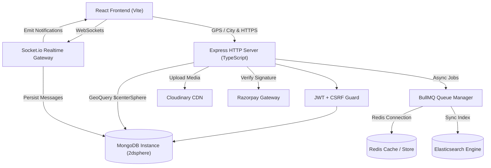
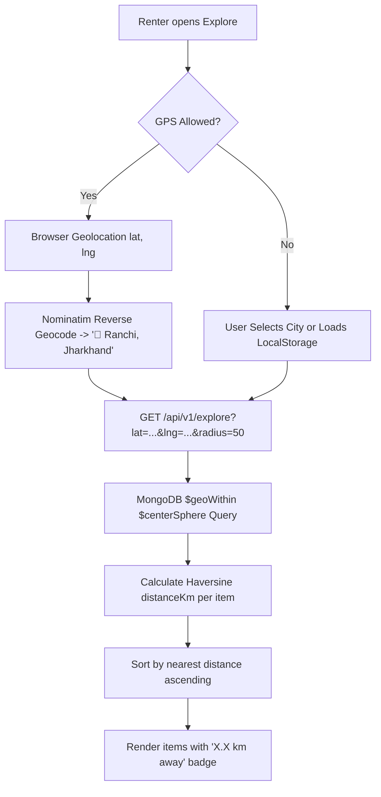
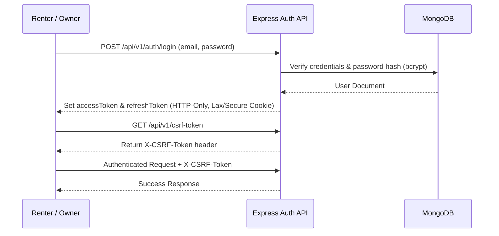
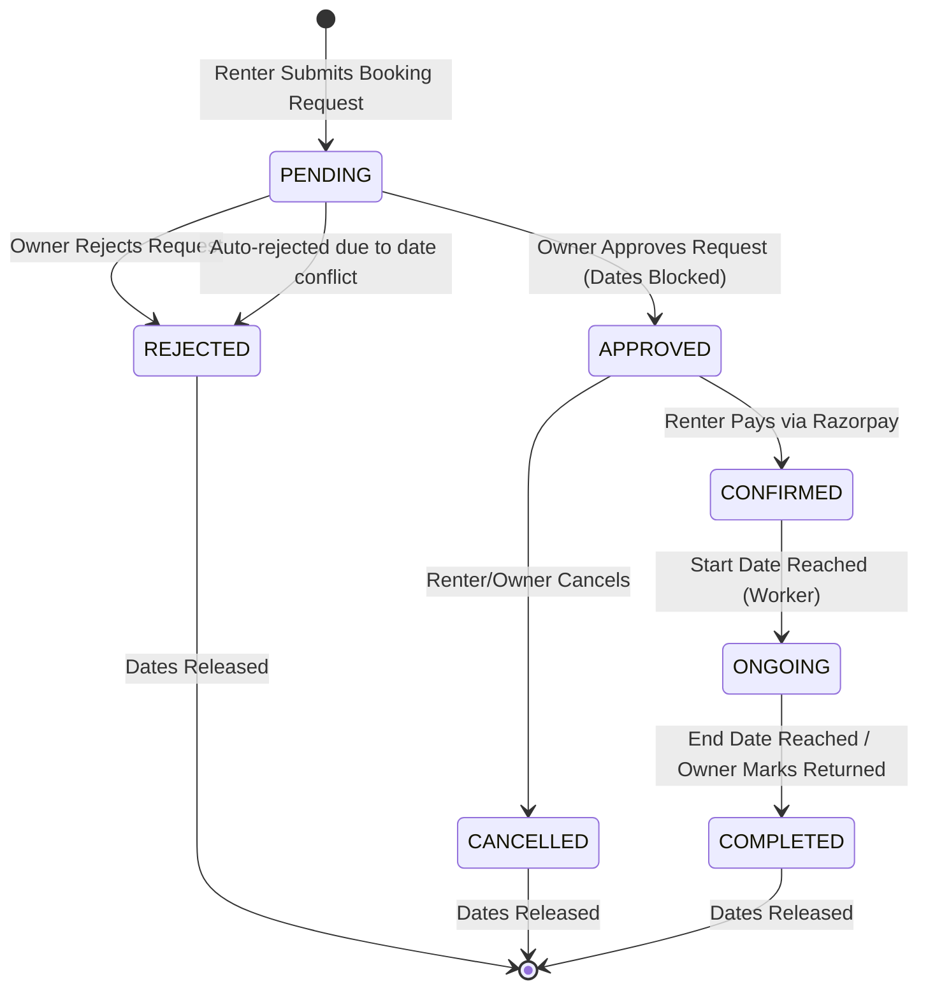
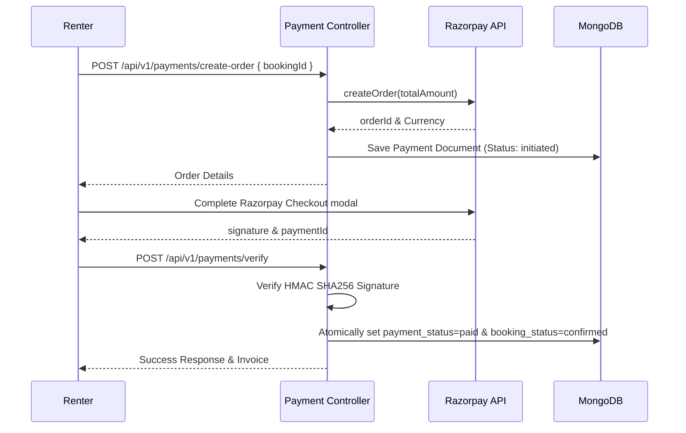

# Rentora — Premium Peer-to-Peer Rental Marketplace

Rentora is an enterprise-grade, peer-to-peer (P2P) rental platform designed for listing, discovering, renting, and managing items in local communities. Built with **Node.js, Express, TypeScript, React (Vite), MongoDB, Redis, BullMQ, Socket.io, Elasticsearch, and Razorpay**, Rentora combines modern Clean Architecture with strict business workflows to deliver a seamless rental experience.

---

## 📋 Table of Contents
- [Overview](#-overview)
- [Key Features](#-key-features)
- [System Architecture](#-system-architecture)
- [Tech Stack](#-tech-stack)
- [Project Directory Structure](#-project-directory-structure)
- [Core Business Lifecycles](#-core-business-lifecycles)
  - [1. Location-Aware Discovery & Geo-Search](#1-location-aware-discovery--geo-search)
  - [2. Authentication & Security Flow](#2-authentication--security-flow)
  - [3. Booking Lifecycle & State Machine](#3-booking-lifecycle--state-machine)
  - [4. Payment Integration (Razorpay)](#4-payment-integration-razorpay)
  - [5. Real-time Socket.io Chat](#5-real-time-socketio-chat)
  - [6. Notification System](#6-notification-system)
  - [7. Elasticsearch & MongoDB Search](#7-elasticsearch--mongodb-search)
  - [8. Asynchronous Jobs & BullMQ Workers](#8-asynchronous-jobs--bullmq-workers)
  - [9. Media Management (Cloudinary)](#9-media-management-cloudinary)
- [Database Schemas](#-database-schemas)
- [Environment Variables](#-environment-variables)
- [Installation & Setup](#-installation--setup)
- [API Documentation](#-api-documentation)
- [Security Implementation](#-security-implementation)
- [License](#-license)

---

## 🌟 Overview

Rentora addresses the inefficiencies of seasonal item ownership by enabling item owners to monetize unused assets while providing renters affordable, short-term access to tools, electronics, vehicles, outdoor gear, and apparel.

The engineering behind Rentora guarantees:
- **Location-Aware Discovery**: Real-time GPS detection, automatic reverse geocoding, 2dsphere spatial indexing, and Haversine distance calculations.
- **Strict Booking Lifecycle**: Prevent double-booking race conditions through Mongoose transaction sessions.
- **Asynchronous Data Pipelines**: BullMQ queues handle email dispatch and real-time Elasticsearch indexing.
- **Robust Security**: Multi-tenant authorization, HTTP-Only JWT cookies, Double CSRF tokens, and rate limiting.

---

## ✨ Key Features

### For Renters
- 🛰️ **Location-Aware Discovery**: Automatic browser GPS detection with reverse geocoding (`📍 Ranchi, Jharkhand`), configurable radius filters (5km–100km), and proximity distance sorting.
- 📍 **Manual Location Override**: Select any city manually or search specific locations while preserving search history in `localStorage`.
- 🔍 **Full-Text & Fuzzy Search**: Multi-field search powered by Elasticsearch with instant fallback to MongoDB regex.
- 📅 **Dynamic Availability Calendar**: Real-time disabled date rendering for approved, confirmed, and ongoing rentals.
- 💳 **Secure Payments**: Razorpay integration with signature verification and idempotency guards.
- 💬 **1-on-1 Live Chat**: Real-time Socket.io messaging authenticated via JWT cookies.
- 🔔 **Instant Notifications**: In-app notifications with unread counts and direct route navigation.

### For Owners
- 🏠 **Automatic Profile Location Inheritance**: New listings automatically inherit the owner's saved profile city without requiring manual re-entry.
- 📦 **Inventory Management**: Add, update, pause, activate, or delete listings with automatic Elasticsearch queue sync and spatial re-geocoding.
- 📥 **Booking Approval Workflow**: Review pending booking requests, accept to hold inventory, or reject with custom messages.
- 📊 **Earnings Analytics**: Real-time tracking of gross earnings, net payouts, and standardized 10% platform commissions.
- 🚀 **Automated Status Progression**: Background workers automatically transition bookings from `confirmed` $\rightarrow$ `ongoing` $\rightarrow$ `completed`.

---

## 🏗️ System Architecture



---

## 🛠️ Tech Stack

### Backend Infrastructure
- **Runtime**: Node.js v18+ (TypeScript)
- **Framework**: Express.js
- **Database**: MongoDB (Mongoose ORM with `2dsphere` spatial indexing)
- **Caching & Message Broker**: Redis, BullMQ
- **Search Engine**: Elasticsearch v8
- **Geocoding**: OpenStreetMap Nominatim API + Haversine Formula Utility
- **WebSockets**: Socket.io v4
- **Payment Gateway**: Razorpay Node SDK
- **Storage CDN**: Cloudinary Node SDK
- **Logging & Monitoring**: Winston Logger, Sentry

### Frontend Infrastructure
- **Framework**: React 18 (Vite)
- **Routing**: React Router v7
- **Styling**: Vanilla CSS3, Tailwind CSS, Lucide Icons
- **HTTP Client**: Native Fetch API with `apiClient` wrapper
- **State & Geolocation**: React Hooks, Browser Geolocation API, LocalStorage Caching, React Hot Toast

---

## 📁 Project Directory Structure

```
Rentora/
├── backend/
│   ├── src/
│   │   ├── config/          # Centralized config (Redis, Socket.io, Mongoose, Sentry, Cloudinary)
│   │   ├── controllers/     # HTTP Request/Response orchestrators
│   │   ├── middlewares/     # Auth checks (verifyUser, restrictTo), CSRF guards, Global Error Handler
│   │   ├── models/          # Mongoose schemas (User, Item with 2dsphere location, Booking, Message, etc.)
│   │   ├── payments/        # Strategy pattern interface (IPaymentProvider) & Razorpay implementation
│   │   ├── queues/          # BullMQ queue producers (email, bookingStatus, elasticSync)
│   │   ├── routes/          # Express API route declarations
│   │   ├── scripts/         # Idempotent migration scripts (migrateGeoCoordinates.ts)
│   │   ├── service/         # Domain business logic layer (explore, items, booking, payment, notification)
│   │   ├── utils/           # Geocoder, Pricing calculator, AppError, Async wrapper, token utilities
│   │   ├── validators/      # Zod validation schemas
│   │   ├── workers/         # BullMQ consumer workers (email, booking status, ES sync)
│   │   ├── app.ts           # Express application initialization & middleware stack
│   │   └── server.ts        # HTTP & Socket.io server bootstrap
├── frontend/
│   ├── src/
│   │   ├── assets/          # Static brand logos and imagery
│   │   ├── components/      # Modular UI components (ExploreLocationBar, ExploreCard, Rentals, etc.)
│   │   ├── context/         # React Contexts (SocketContext)
│   │   ├── hooks/           # Custom hooks (useAuth, homeRedirect, apiClient)
│   │   ├── layouts/         # Page layout wrappers (GuestLayout, RenterLayout, OwnerLayout)
│   │   ├── pages/           # Page view views (Explore, ItemDetails, Dashboard, Messages, Checkout)
│   │   ├── App.jsx          # Router & Route guards
│   │   └── main.jsx         # Vite entrypoint
```

---

## 🔄 Core Business Lifecycles

### 1. Location-Aware Discovery & Geo-Search
Rentora calculates spatial distance using MongoDB `$geoWithin` spherical queries and Haversine distance calculations.



### 2. Authentication & Security Flow
Rentora uses HTTP-Only cookies for JWT management alongside Double CSRF protection.



### 3. Booking Lifecycle & State Machine
The booking state machine enforces strict financial and inventory boundaries.



### 4. Payment Integration (Razorpay)
Payment processing is decoupled using the Strategy Pattern (`IPaymentProvider`).



---

## 🔑 Environment Variables

Create a `.env` file inside the `backend/` directory:

```env
NODE_ENV=development
PORT=3000
MONGO_URI=mongodb://localhost:27017/rentora
CLIENT_URL=http://localhost:5173

JWT_ACCESS_SECRET=your_super_secret_jwt_access_key_12345
JWT_REFRESH_SECRET=your_super_secret_jwt_refresh_key_67890
JWT_ACCESS_EXPIRY=15m
JWT_REFRESH_EXPIRY=7d

SESSION_SECRET=your_random_session_secret_key

RAZORPAY_KEY_ID=rzp_test_your_key_id
RAZORPAY_KEY_SECRET=your_razorpay_secret

ELASTIC_SEARCH_URL=http://localhost:9200
ELASTIC_API_KEY=your_elastic_api_key

CLOUDINARY_CLOUD_NAME=your_cloud_name
CLOUDINARY_API_KEY=your_cloudinary_key
CLOUDINARY_API_SECRET=your_cloudinary_secret
```

---

## ⚡ Installation & Setup

### Prerequisites
- Node.js v18+ & npm
- MongoDB local instance or MongoDB Atlas URI
- Redis server instance (running on port 6379)

### 1. Clone & Install Dependencies
```bash
git clone https://github.com/priyanshuraj20/Rentora.git
cd Rentora

# Backend setup
cd backend && npm install

# Frontend setup
cd ../frontend && npm install
```

### 2. Run Geocoding Data Migration (One-time)
```bash
cd backend
npx ts-node -r tsconfig-paths/register src/scripts/migrateGeoCoordinates.ts
```

### 3. Start Development Servers
```bash
# Start backend
cd backend && npm run dev

# Start frontend
cd frontend && npm run dev
```

---

## 📜 License

Distributed under the **MIT License**. See `LICENSE` for details.