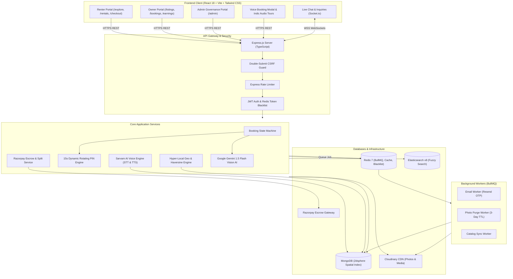
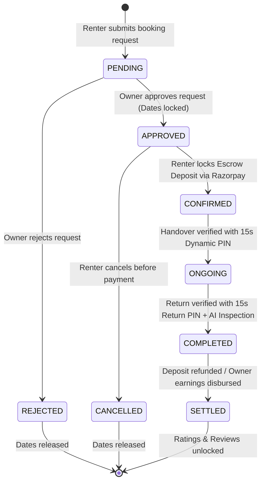

# Rentora — Autonomous Peer-to-Peer Rental Marketplace

> **Rentora** is a location-aware peer-to-peer (P2P) equipment rental marketplace engineered with **Node.js, TypeScript, Express, React 18, MongoDB, Redis, BullMQ, Socket.io, Elasticsearch, Sarvam AI (Saaras STT + Bulbul TTS), Google Gemini Vision AI, and Razorpay Escrow**.

[](https://github.com)
[-purple?style=flat-square)](https://sarvam.ai)
[](https://ai.google.dev)
[](https://razorpay.com)
[](https://elastic.co)
[](https://github.com)

---

## 🌟 Overview

Rentora enables item owners to monetize idle high-value assets (cameras, drones, power tools, bikes, camping gear) while giving renters affordable short-term access.

Instead of manual forms and insecure cash handshakes, Rentora delivers:
1. **Autonomous Indic Voice Search**: Search gear, check open dates, and build booking cards simply by speaking in Hinglish, Hindi, or English without typing.
2. **15-Second Dynamic Rotating PIN**: Uber-style live TOTP mutual verification code that auto-refreshes every 15s to eliminate false delivery claims and screenshot fraud.
3. **Automated Razorpay Escrow**: 100% of rental fees and security deposits are held in Admin Escrow until verified return. Owners receive 90% net rental earnings (10% platform fee) only after successful return & photo verification, while deposits are refunded to renters via Razorpay.
4. **Multimodal AI Return Inspection**: Google Gemini 1.5 Flash compares Handover vs. Return condition photos to detect damage and automate deposit settlements.
5. **Interactive Voice Dashboard Guides**: Voice-guided onboarding in English, Hindi, Gujarati, and Marathi with real-time UI element spotlights.
6. **Real-Time Messaging**: WebSocket-powered chat with conversation search, delete/clear options, and one-tap quick replies.

---

## 🚀 Key Features & Differentiators

| Core Feature | Technical Implementation | Purpose & Benefit |
|---|---|---|
| 🎙️ **Autonomous Indic Voice Booking** | Sarvam AI Saaras STT (`saaras:v4`) + Indic NLP Parser + Bulbul TTS (`bulbul:v2`) | Rent gear by speaking in Hinglish, Hindi, or English; auto-matches inventory, validates dates, and builds escrow checkout cards |
| 🔐 **15s Dynamic Rotating PIN** | 6-digit TOTP delivery PIN auto-rotating every 15 seconds with grace window | Prevents screenshot theft and delivery disputes; physical handover is verified in-person with zero awkwardness |
| 💳 **Platform Escrow & Split Payment** | Razorpay Escrow + Automated Instant Refund API | Security deposits held in platform escrow; 10% platform fee retained, 90% net earnings transferred to Owner |
| 🤖 **Multimodal AI Return Inspection** | Google Gemini 1.5 Flash comparing Handover vs Return photos | Automated visual damage assessment, repair cost estimation, and objective deposit deductions |
| 🛡️ **Autonomous Risk Guard** | Real-time AI damage categorization (`TIER_0` to `TIER_3`) | Suspends malicious accounts (`isBlocked=true`) on severe damage/total loss without manual tickets |
| 🗣️ **Synchronized Indic Audio Tours** | Sarvam Bulbul TTS Streaming WAV + DOM focus spotlighting | Guided interactive audio walkthroughs for Renters and Owners in 4 verified languages with on-screen element highlighting |
| 📍 **Hyper-Local GPS Discovery** | Nominatim Reverse Geocoding + MongoDB `2dsphere` Index | 1-click GPS auto-detection, locality tagging (e.g., Indiranagar, Alkapuri), radius filtering, and Haversine distance calculations |
| 💬 **Live Chat with Options & Search** | Socket.io WebSockets + MongoDB persistence | Live messaging with conversation search, delete chat history, mute notifications, and smart quick action chips |
| 🔍 **Zero-Downtime Smart Search** | Elasticsearch v8 Fuzzy Search + MongoDB Regex Fallback | Resilient search experience that automatically falls back to MongoDB regex if Elasticsearch is unavailable |
| ⚡ **Background Job Queues** | BullMQ + Redis for asynchronous background tasks | Decoupled email delivery (Resend OTP), catalog sync, and ephemeral condition photo cleanup |

---

## 🏗️ System Architecture



---

## 🔄 Core Workflows

### 1. 15-Second Dynamic Rotating PIN Handover & Return Flow

```mermaid
flowchart TD
    subgraph PickupPhase["1. Physical Pickup Phase (At Owner Location)"]
        P1["Renter pays Escrow Deposit + Rent"] --> P2["Booking Status: CONFIRMED"]
        P2 --> P2B["Upload Pickup Condition Photos (Required Gate)"]
        P2B --> P3["Renter opens 'Show My Handover PIN'"]
        P3 --> P4["Server generates 6-digit PIN (15s TTL + 30s Grace Window)"]
        P4 --> P5["Renter tells/shows live PIN to Owner"]
        P5 --> P6["Owner enters PIN in 'Verify Renter PIN' modal"]
        P6 --> P7{"Server checks Photos, PIN & Rate-Limit"}
        P7 -->|Valid: Current or Grace Window| P8["Status -> ONGOING + Socket.io 'booking_updated' closes Renter PIN modal"]
        P7 -->|Invalid| P9["Attempt count increments (Max 5 attempts -> Risk Guard Block)"]
        P8 --> P10["All Funds remain safely in Admin Escrow (₹0 released upfront)"]
    end

    subgraph ReturnPhase["2. Physical Return Phase (Item Brought Back)"]
        R1["Renter returns equipment to Owner"] --> R2["Owner inspects & uploads Return Condition Photos (Owner-Only Gate)"]
        R2 --> R3["Owner opens 'Show Return PIN' (Rotates every 15s)"]
        R3 --> R4["Owner tells live Return PIN to Renter"]
        R4 --> R5["Renter enters PIN in 'Complete Return' modal"]
        R5 --> R6{"Server validates Photos & Return PIN"}
        R6 -->|Valid| R7["Status -> COMPLETED + Socket.io syncs both screens"]
        R7 --> R8["Gemini AI Inspection -> Refund Security Deposit to Renter & Release 90% Rent to Owner"]
        R6 -->|Invalid| R9["Retry with live fresh PIN"]
    end
```



---

### 2. Escrow Payment & Gemini AI Damage Settlement Flow

```mermaid
flowchart TD
    Start["Renter Initiates Booking"] --> Calc["Server Pricing Engine computes Rent + Security Deposit"]
    Calc --> RazorpayOrder["Create Razorpay Order (Total = Rent + Security Deposit)"]
    RazorpayOrder --> PaymentCaptured["Renter completes checkout via UPI / Card"]
    PaymentCaptured --> EscrowLock["100% Funds locked in Admin Escrow (₹0 paid to Owner upfront)"]
    EscrowLock --> HandoverDone["Pickup verified via Photos + 15s Dynamic PIN -> ONGOING"]
    HandoverDone --> ItemReturned["Return verified via Owner Photos + 15s Return PIN -> COMPLETED"]
    ItemReturned --> GeminiAI["Google Gemini 1.5 Flash Vision Inspection (Pickup vs Return Photos)"]
    GeminiAI --> DamageCheck{"Inspect Condition & Settle Escrow"}
    DamageCheck -->|TIER 0: Clean Return (No Damage)| FullRefund["100% Security Deposit refunded to Renter + 90% Rent to Owner (10% Fee to Admin)"]
    DamageCheck -->|TIER 1/2: Minor or Moderate Damage| PartialDeduction["Deduct Repair Cost from Deposit -> Owner gets 90% Rent + Repair Cost"]
    PartialDeduction --> RemainderRefund["Refund remaining deposit balance to Renter via Razorpay"]
    DamageCheck -->|TIER 3: Severe Destruction / Total Loss| Forfeit["100% Deposit + 90% Rent to Owner + Malicious User Suspended"]
    FullRefund --> Settled["Booking Settled & Closed"]
    RemainderRefund --> Settled
    Forfeit --> Settled
```

---

### 3. Autonomous Indic Voice Search & Booking Flow

```mermaid
flowchart LR
    A["Renter speaks in Hinglish, Hindi, or English"] --> B["Browser MediaRecorder captures audio"]
    B --> C["POST /api/v1/voice/agent"]
    C --> D["Sarvam AI Saaras v4 STT"]
    D --> E["Devanagari & Indic NLP Parser"]
    E --> F["Extract Item Keyword, City & Duration"]
    F --> G["Query MongoDB Active Inventory"]
    G --> H["Calculate Escrow Rent & Deposit"]
    H --> I["Sarvam Bulbul v2 TTS synthesizes audio response"]
    I --> J["Instant Booking Card displayed in UI with Autoplay Speech"]
    J --> K["1-Click navigation to Razorpay Checkout"]
```



---

### 4. Hyper-Local GPS & Geo-Search Flow

```mermaid
flowchart LR
    A["User Opens Explore"] --> B{"Choose Location Mode"}
    B -->|1-Click GPS| C["Browser Geolocation (lat, lng)"]
    C --> D["Nominatim Reverse Geocoding"]
    D --> E["Detect Locality (e.g., Indiranagar) & City (e.g., Bangalore)"]
    B -->|Select Registered City| E
    
    E --> F["Select Radius Filter: 5km | 10km | 20km | 50km | 100km"]
    F --> G["GET /explore?lat=..&lng=..&radius=..&city=.."]
    G --> H["MongoDB 2dsphere $geoWithin $centerSphere Query"]
    H --> I["Haversine Formula computes precise distance per item"]
    I --> J["Sort listings by proximity ascending"]
    J --> K["Render cards with '📍 Area, City' & Distance Badge"]
```



---

### 5. Booking State Machine Transitions



---

## 🛠️ Complete Marketplace Features

### 🧑‍💼 Renter Features
1. **Autonomous Voice-to-Booking Agent**: Search active inventory, validate dates, and build instant booking cards without typing.
2. **Interactive Date Picker & Escrow Calculator**: Choose custom dates and duration chips (`1D`, `2D`, `3D`, `1 Week`) with dynamic price and deposit calculations.
3. **Location-Aware Geospatial Discovery**: Discover verified gear nearby using browser GPS and MongoDB `2dsphere` indexing.
4. **1-Click Razorpay Escrow Protection**: Rent and refundable deposits are locked safely in escrow until verified pickup.
5. **15-Second Dynamic Delivery PIN**: Time-based rotating PIN displayed in the renter dashboard; cannot be claimed or forged remotely.
6. **Real-Time Live Chat with Owners**: Direct Socket.io chat with conversation search, delete chat history, and quick reply chips.
7. **Transparent Booking Lifecycle Tracker**: Clear step-by-step progress tracking: `Requested → Approved → Escrow Locked → Active Rental → Returned → Deposit Refunded`.
8. **Wishlist & Equipment Bookmarking**: Save gear to personal collections for upcoming projects and shoots.

### 💼 Owner Features
1. **Quick Asset Listing & Photo Management**: Cloudinary-backed multi-photo listing with condition tagging, category assignment, and usage guidelines.
2. **Custom Rental Rates & Deposit Controls**: Define tiered daily rates alongside mandatory damage security deposits.
3. **15-Second Dynamic Rotating PIN Verification**: Verify the renter's live 15-second dynamic PIN at pickup for dispute-free handover.
4. **Escrow Payouts After Verified Return**: Revenue (90% of rent, 10% platform fee) is disbursed to the owner only after successful item return and AI photo verification, protecting renters from upfront no-shows.
5. **Booking Request Management**: Review renter profiles, requested rental dates, and projected earnings before approving bookings.
6. **Live Earnings & Inventory Dashboard**: Real-time revenue metrics, active rental counters, equipment status, and payout history.
7. **Owner Guided Indic AI Audio Tour**: Synchronized audio guide in English, Hindi, Gujarati, and Marathi with on-screen UI spotlighting.

### 🛡️ Platform & Security Features
1. **Sarvam AI Indic Voice Engine**: Saaras STT and Bulbul TTS integration supporting Hindi, Gujarati, Marathi, and English.
2. **15-Second Dynamic PIN Engine**: Brute-force-protected dynamic PIN rotation with grace window handling and auto-countdown.
3. **Google Gemini Multimodal AI**: Automated damage detection comparing pre-handover and post-return condition photos.
4. **Role-Based Access Control (RBAC)**: Route guards and layouts segregating Guest, Renter, Owner, and Admin governance.
5. **Admin Governance & Escrow Dispute Portal**: Platform GMV tracking, escrow dispute arbitration, and user moderation.
6. **Dual Search Engine with Fallback**: Elasticsearch fuzzy query cluster with instant failover to MongoDB regex search.
7. **Multi-Layer Web Security**: HTTP-only cookies, Redis token blacklisting on logout, double CSRF verification, rate limiting, and bcrypt hashing.
8. **BullMQ & Redis Background Queues**: Asynchronous worker queues offloading email notifications, photo purging, and scheduled booking status transitions.
9. **Centralized Pricing Engine**: Tamper-proof server-side rate calculator preventing client-side amount manipulation.

---

## 💻 Tech Stack

### Backend
| Technology | Version / Purpose |
|---|---|
| **Node.js + TypeScript** | Strongly typed, modular server runtime |
| **Express.js v5** | REST API framework and middleware pipeline |
| **Sarvam AI SDK** | Indic Voice: Saaras STT (`saaras:v4`) & Bulbul TTS (`bulbul:v2`) |
| **Google Gemini 1.5 Flash** | Multimodal computer vision AI damage inspection |
| **MongoDB + Mongoose** | Document database with 2dsphere spatial indexing |
| **Redis 7 (ioredis)** | BullMQ queue broker, token blacklist, and geocoder caching |
| **BullMQ** | Reliable asynchronous job and delay queue management |
| **Razorpay SDK** | Escrow payments, bank transfers, and automated refunds |
| **Elasticsearch v8** | Full-text fuzzy search engine with MongoDB regex fallback |
| **Socket.io v4** | Bidirectional real-time messaging and notifications |
| **Cloudinary SDK** | Cloud image storage and asset purging |
| **Resend** | Transactional email delivery for OTP verification |
| **Zod** | Runtime schema and request payload validation |
| **Bcryptjs & JWT** | Password hashing and stateless authentication tokens |

### Frontend
| Technology | Version / Purpose |
|---|---|
| **React 18 / React 19** | Declarative component UI library |
| **Vite 7** | Fast frontend build tool and development server |
| **React Router v7** | Client-side routing with nested role-based guards |
| **Tailwind CSS v4** | Modern utility-first responsive styling with dark theme |
| **Lucide React** | Clean iconography system |
| **Socket.io Client** | Real-time WebSocket connection handling |
| **React Hot Toast** | Dynamic, accessible user feedback alerts |
| **Web Audio & MediaRecorder** | In-browser microphone audio capture and WAV playback |

---

## 📁 Directory Structure

```
Rentora/
├── backend/
│   ├── src/
│   │   ├── config/          # Redis, Socket.io, Mongoose, Cloudinary, Razorpay, Logger config
│   │   ├── controllers/     # HTTP controllers (admin, auth, booking, items, payments, voice, message)
│   │   ├── middlewares/     # verifyUser, restrictTo, double-submit CSRF, upload, rateLimiter
│   │   ├── models/          # Schemas: User, Item, Booking, Payment, Message, Review, Notification
│   │   ├── payments/        # Strategy Pattern: IPaymentProvider & RazorpayPaymentProvider
│   │   ├── queues/          # BullMQ queue producers (email, status, ES sync, photo purge)
│   │   ├── routes/          # Express routes (admin, auth, booking, explore, items, voice, messages)
│   │   ├── service/         # Domain services (booking, explore, items, payment, voice, voiceAgent, message)
│   │   ├── utils/           # Geocoder, pricing calculator, AppError
│   │   ├── validators/      # Zod validation schemas
│   │   ├── workers/         # BullMQ queue consumers & background processors
│   │   ├── app.ts           # Express application configuration
│   │   └── server.ts        # Bootstrap entrypoint for HTTP & Socket.io
├── frontend/
│   ├── src/
│   │   ├── assets/          # Static brand icons and images
│   │   ├── components/      # UI components (admin_ui, owner_ui, renter_ui, guest_ui, common)
│   │   │   ├── common/      # VoiceBookingAgentModal, VoiceWelcomeWidget, PINDisplayModal, PINInputModal
│   │   │   ├── owner_ui/    # OwnerVoiceGuide, BookingCard, QuickActions, StatsCard
│   │   │   ├── renter_ui/   # RenterVoiceGuide, ExploreSearchBar, RentCheckoutLayout, RentalCalendar
│   │   ├── context/         # Socket and Auth React contexts
│   │   ├── hooks/           # Custom React hooks (useAuth, apiClient, homeRedirect)
│   │   ├── layouts/         # Layout wrappers (AdminLayout, GuestLayout, OwnerLayout, RenterLayout)
│   │   ├── pages/           # Pages (guest/Features, owner/OwnerDashboard, renter/RentalDetails, common/Messages)
│   │   ├── App.jsx          # Route definitions & ProtectedRoute wrapper
│   │   └── main.jsx         # Client mount entrypoint
```

---

## 🔒 Security Architecture

| Security Layer | Implementation Details |
|---|---|
| **Authentication** | Access Token (15 min) + Refresh Token (7 days) stored in HTTP-Only, SameSite cookies |
| **Token Invalidation** | Redis-backed token blacklist; instant session termination on logout |
| **CSRF Defense** | Double-submit cookie pattern verified with constant-time `crypto.timingSafeEqual` |
| **Autonomous Risk Guard** | Auto-suspension (`isBlocked=true`) triggered by AI on severe item damage |
| **Dynamic 15s PIN Handover** | 6-digit TOTP PIN (15s TTL + 30s grace), mandatory condition-photo gate, `409` state-lock, Socket.io live sync, and 5-attempt lockout |
| **Input Sanitization** | Strict Zod validation on every request body, query parameter, and path parameter |
| **Rate Limiting** | `express-rate-limit` prevents brute force on auth, voice, and sensitive endpoints |
| **HTTP Hardening** | Helmet headers (CSP, HSTS, X-Frame-Options) and strict CORS origin checks |

---

## 🔑 Environment Configuration

### Backend Configuration (`backend/.env`)

```env
NODE_ENV=development
PORT=3000
MONGO_URI=mongodb+srv://<username>:<password>@cluster0.mongodb.net/Rentora?retryWrites=true&w=majority
CLIENT_URL=http://localhost:5173

# Authentication & Secrets
JWT_ACCESS_SECRET=your_jwt_access_secret_here
JWT_REFRESH_SECRET=your_jwt_refresh_secret_here
SESSION_SECRET=your_session_secret_here
JWT_ACCESS_EXPIRY=15m
JWT_REFRESH_EXPIRY=7d

# Cache & Queues
REDIS_URL=redis://localhost:6379

# Sarvam AI (Indic Voice: Saaras STT & Bulbul TTS)
SARVAM_API_KEY=your_sarvam_api_key_here

# Google Gemini Vision AI (Damage Inspection)
GEMINI_API_KEY=your_gemini_api_key_here

# Payment Gateway (Razorpay Escrow)
RAZORPAY_KEY_ID=rzp_test_your_key_id
RAZORPAY_KEY_SECRET=your_razorpay_secret

# Cloudinary Media Storage
CLOUDINARY_CLOUD_NAME=your_cloud_name
CLOUDINARY_API_KEY=your_cloudinary_key
CLOUDINARY_API_SECRET=your_cloudinary_secret

# Search Engine (Optional - Mongo regex fallback activates automatically if empty)
ELASTIC_SEARCH_URL=http://localhost:9200
ELASTIC_API_KEY=your_elastic_key

# Transactional Email (Resend)
RESEND_API_KEY=your_resend_api_key
MAIL_USER=your_email@gmail.com
```

### Frontend Configuration (`frontend/.env`)

```env
VITE_BACKEND_URL=http://localhost:3000/api/v1
VITE_RAZORPAY_KEY_ID=rzp_test_your_key_id
```

---

## ⚡ Quick Start

### Prerequisites
- **Node.js** v18+ & **npm**
- **MongoDB** (Local instance or MongoDB Atlas cluster)
- **Redis Server** (Port 6379)
- **Sarvam AI API Key** *(For Indic Voice Agent and Audio Dashboard Guides)*
- **Razorpay Test Keys** *(For Escrow and Deposit testing)*

### Step 1: Clone Repository
```bash
git clone https://github.com/priyanshuraj20/Rentora.git
cd Rentora
```

### Step 2: Install Dependencies
```bash
# Install backend dependencies
cd backend
npm install

# Install frontend dependencies
cd ../frontend
npm install
```

### Step 3: Configure Environment Variables
Create `.env` in both `backend/` and `frontend/` using the templates provided above.

### Step 4: Run Geocoding Migration (One-Time)
```bash
cd backend
npx ts-node -r tsconfig-paths/register src/scripts/migrateGeoCoordinates.ts
```

### Step 5: Start Development Servers
```bash
# Terminal 1: Backend Server (Port 3000)
cd backend
npm run dev

# Terminal 2: Frontend Client (Port 5173)
cd frontend
npm run dev
```

Visit **`http://localhost:5173`** in your browser.

---

## 🧠 Key Design Patterns

1. **Clean Layered Architecture**: Strict separation of concerns: `Routes` → `Middlewares` → `Controllers` → `Services` → `Models`.
2. **Strategy Pattern**: Abstracted `IPaymentProvider` allowing seamless swapping of payment gateways.
3. **State Machine Pattern**: Deterministic state transitions for the booking lifecycle preventing invalid statuses.
4. **Observer & WebSocket Pattern**: Real-time Socket.io event broadcasting decoupled from transaction handling.
5. **Decoupled Queue Architecture**: Asynchronous BullMQ background worker execution for media purging, emails, and catalog synchronization.
6. **Dynamic TOTP Verification**: 15-second auto-rotating cryptographic PINs coupled with condition photo evidence for zero-dispute peer handovers.

---

## 📜 License

Distributed under the **MIT License**. Created by [Priyanshu Raj](https://github.com/priyanshuraj20).
